# MicroHydros Node-RED flows: a beginner's guide

How the three Node-RED tabs of MicroHydros are built, node by node, and how they work together.

**Who this is for:** you know roughly what a sensor and a web page are, but you have never opened Node-RED. After this guide you can read the flows, rebuild them by hand, test each step, and change them safely.

**How to read it:** part 1 teaches Node-RED itself. Parts 2 to 6 walk through the flows. Parts 7 to 11 explain how the pieces cooperate, where secrets live, how to rebuild the generated flow, what to do when something breaks, and how to add a sensor.

> The files in the repository are the truth. This guide explains them. If the guide and a file ever disagree, the file wins: `docker/node-red/flows/*.json` and `docker/node-red/leaflimits/src/*.js`.

| Part | Content |
|---|---|
| 1 | Node-RED in ten minutes |
| 2 | The big picture: three tabs, one broker |
| 3 | Before you start: two ways to get the flows |
| 4 | Tab 1: MQTT Validation |
| 5 | Tab 2: InfluxDB storage |
| 6 | Tab 3: LeafLimits (four sections) |
| 7 | How the tabs work together |
| 8 | Configuration and secrets |
| 9 | The build pipeline of the LeafLimits tab |
| 10 | Troubleshooting |
| 11 | Recipe: add a new sensor |
| 12 | Glossary |
| A, B | Appendix: the complete code of the two team functions |

---

# 1. Node-RED in ten minutes

Node-RED is a tool where you build programs by drawing. You drag boxes onto a canvas and connect them with lines. Each box does one small job. A line says "when you are done, hand your result to the next box".

## 1.1 The editor

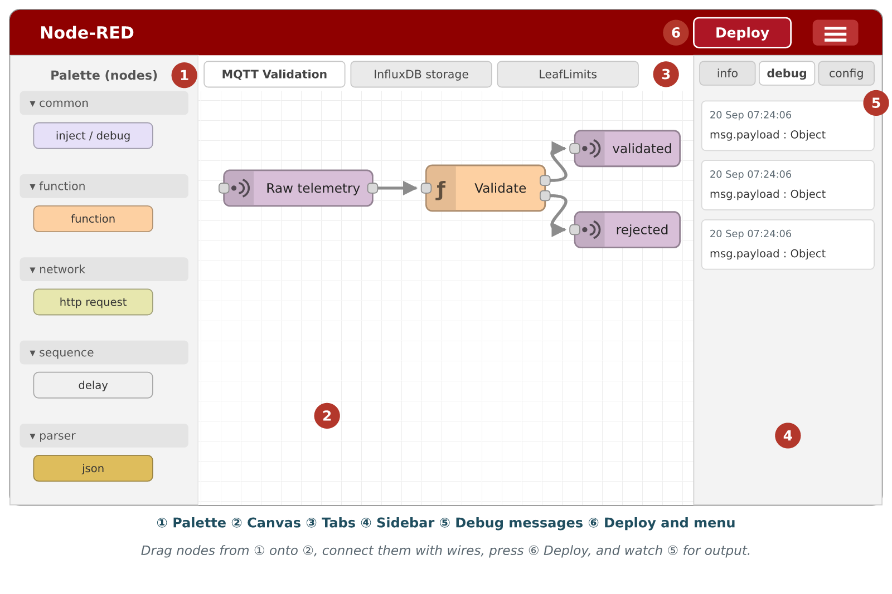

| # | Part | What it is for |
|---|---|---|
| 1 | Tabs | One tab is one flow, a group of boxes that belong together. This project has three. |
| 2 | Palette | The list of available node types. Drag from here onto the canvas. |
| 3 | Canvas | The drawing area. Boxes are nodes, lines are wires. |
| 4 | Sidebar | Shows the properties of the selected node, the debug messages, and the context data. |
| 5 | Deploy button | Nothing you draw runs until you press it. It sends your drawing to the server. |

Two things trip up every beginner:

1. **Drawing is not running.** Until you press **Deploy**, the server still runs the old version.
2. **A tab can be disabled.** A disabled tab is drawn greyed out and does nothing, even when deployed.

## 1.2 The four words you must know

| Word | Meaning | Real-life comparison |
|---|---|---|
| **Node** | One box with one job | A worker at a station |
| **Wire** | A line from one node's output to another node's input | A conveyor belt between two stations |
| **Message (`msg`)** | The thing that travels along wires | The parcel on the belt |
| **Flow** | A tab with its nodes and wires | One production line |

## 1.3 What a node looks like

Nodes have a colour and an icon so you can recognise the type. The pictures in this guide copy that look.

| Node type | Colour | What it does | Used in this project for |
|---|---|---|---|
| **mqtt in** | purple | Waits for messages on an MQTT topic | Receiving sensor readings |
| **mqtt out** | purple | Publishes a message to an MQTT topic | Sending validated readings and alerts |
| **function** | orange | Runs your own JavaScript | Validation, alert logic, the API |
| **json** | yellow | Converts text to an object | Reading the validated message |
| **http request** | pale yellow with a globe | Calls a web address | Writing to InfluxDB, asking Claude |
| **http in** | pale yellow with a globe | Waits for a web request | The LeafLimits API and the app |
| **http response** | pale yellow with a globe | Sends the answer back to whoever asked | Ending every API route |
| **file in** | yellow | Reads a file from disk | Serving the web app files |
| **debug** | green | Prints the message in the sidebar | Watching what happens |
| **inject** | blue | Sends a message when you click it | Testing without hardware |
| **catch** | red | Receives errors from other nodes | Turning failures into replies |
| **comment** | grey text | A note on the canvas, does nothing | Section headings |

A node with a **small square on its left** has an input. A **square on its right** is an output. A function node can have several outputs, which lets it choose where the message goes next.

## 1.4 The message

Everything that moves between nodes is a JavaScript object called `msg`. The important field is `msg.payload`, the actual data. Other fields carry extra facts: `msg.topic` is the MQTT topic, `msg.statusCode` is a web status such as 200 or 404.

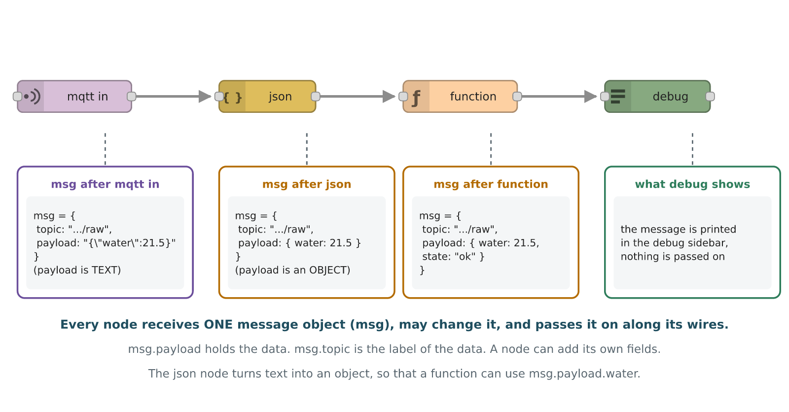

Each node can read the message, change it and pass it on. The figure shows a typical trip: **mqtt in** creates the message with the text that arrived, **json** turns the text into an object, a **function** node changes the fields, and **debug** shows the result.

## 1.5 The function node in five lines

A function node holds JavaScript. It receives `msg` and must `return` something.

```javascript
// return the message: it continues on the wire
msg.payload = msg.payload * 2;
return msg;

// return null: the message stops here (nothing is sent)
return null;

// two outputs: [goes-to-output-1, goes-to-output-2], null means "nothing on this one"
return [msg, null];
```

Four things are always available inside a function node:

| Name | What it is | Example |
|---|---|---|
| `msg` | The incoming message | `msg.payload` |
| `flow` | Memory shared by every node in the same tab | `flow.set('x', 1)`, `flow.get('x')` |
| `global` | Memory shared by all tabs | `global.get('x')` |
| `env` | Settings and secrets (section 8) | `env.get('INFLUXDB_URL')` |
| `node` | The node itself, for logging | `node.warn('careful')`, `node.error('failed')` |

## 1.6 Import and export

A whole tab is stored as **JSON text**: a list with one entry per node, with its position, its properties and its wires (the ids of the next nodes). That is what you find in `docker/node-red/flows/*.json`. In the editor use the menu (top right) and choose **Import** to load such a file and **Export** to save one. Nothing is lost in the round trip, which is why the repository stores flows as JSON.

---

# 2. The big picture

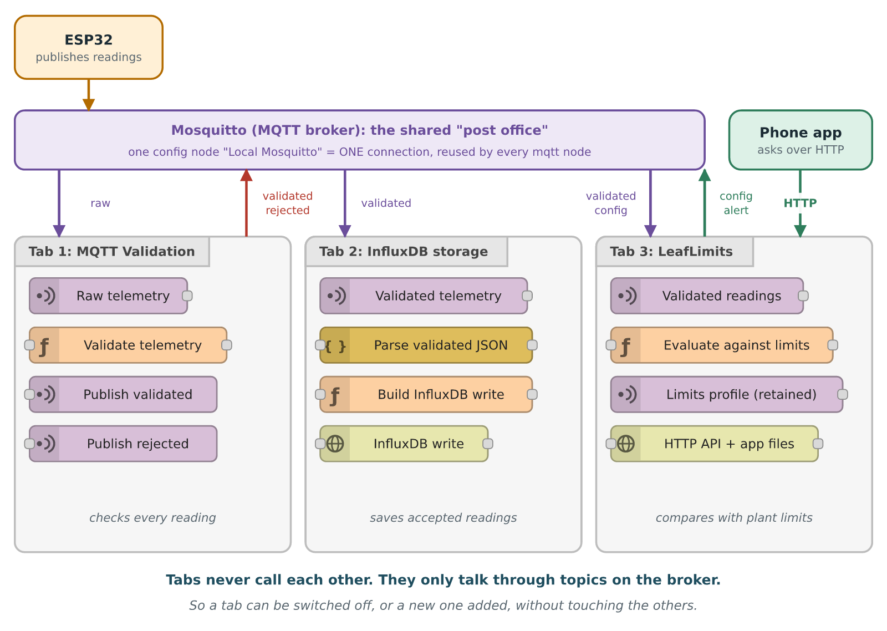

The system is a chain of small programs that never call each other directly. They only **publish** and **subscribe** to topics on the MQTT broker (Mosquitto). This is called *publish/subscribe*: the sender does not know who listens, and the listener does not know who sent.

| Tab | Listens to | Does | Publishes / writes |
|---|---|---|---|
| **1. MQTT Validation** | `microhydros/v1/devices/+/telemetry/raw` | Checks every raw message, splits it into one message per sensor | `.../telemetry/validated/<sensor>` and `.../telemetry/rejected` |
| **2. InfluxDB storage** | `.../telemetry/validated/+` | Turns each reading into InfluxDB text and posts it | The database (bucket `microhydros`) |
| **3. LeafLimits** | `.../telemetry/validated/+` and `.../limits/config` | Compares readings with plant limits, offers a web API and the phone app | `.../limits/alert`, `.../limits/config` (retained) |

The `+` in a topic is a wildcard for exactly one level, so `devices/+/telemetry/raw` matches every device.

**The one rule that keeps this simple:** tab 1 is the only one that reads raw data. Tabs 2 and 3 only read the *validated* topic. If the validation tab were off, tabs 2 and 3 would just sit there waiting.

## 2.1 The topics used

| Topic | Who publishes | Who listens | Retained? |
|---|---|---|---|
| `microhydros/v1/devices/{id}/telemetry/raw` | The ESP32 | Tab 1 | no |
| `microhydros/v1/devices/{id}/telemetry/validated/{measurement}` | Tab 1 | Tabs 2 and 3 | no |
| `microhydros/v1/devices/{id}/telemetry/rejected` | Tab 1 | Nobody yet (kept for debugging) | no |
| `microhydros/v1/devices/{id}/limits/config` | Tab 3 (API save) | Tab 3 | **yes** |
| `microhydros/v1/devices/{id}/limits/alert` | Tab 3 | Anyone (future) | no |

*Retained* means the broker keeps the last message on that topic and hands it to every new subscriber immediately. Tab 3 uses that as its database for the limits (section 6.3).

## 2.2 The measurements

| Field in the ESP32 message | Measurement name | Sensor | Unit | Accepted range |
|---|---|---|---|---|
| `internal_temperature_c` | `internal_temperature` | `internal_sht31` | celsius | -10 to 60 |
| `internal_humidity_percent` | `internal_humidity` | `internal_sht31` | percent_rh | 0 to 100 |
| `external_temperature_c` | `external_temperature` | `external_ds18b20` | celsius | -40 to 60 |
| `water_temperature_c` | `water_temperature` | `water_ds18b20` | celsius | 0 to 50 |

---

# 3. Before you start

## 3.1 What is already running

The project runs in Docker on a server. The Node-RED container reaches the broker under the name `mosquitto` (port 1883 inside Docker; the outside world uses 1884). Node-RED itself is served on port 1881, InfluxDB on 8087 and Grafana on 3002.

## 3.2 Two ways to get the flows

| | A. Import (recommended) | B. Build by hand (to learn) |
|---|---|---|
| How | Editor menu, Import, paste the JSON file | Follow parts 4 to 6 and draw every node |
| Time | 2 minutes | 1 to 2 hours |
| Files | `mqtt-validation.json`, `influxdb-storage.json`, `leaflimits.json` | Same content, typed in |
| Good for | Getting a working system | Understanding it |

Even if you import, read parts 4 to 6. They explain why each node is there.

## 3.3 The shared broker connection

Every mqtt node points at one **configuration node** named *Local Mosquitto* (host `mosquitto`, port 1883). It does not appear on the canvas. It is created once and shared, so all tabs use **one** connection. Create it the first time you add an mqtt node: click the pencil next to *Server*, set Server = `mosquitto`, Port = `1883`, and add.

> The three flow files all carry the same broker config node id (`6fcdce2f11ec0ec3`). That is deliberate: importing a file must reuse the existing connection instead of making a second one.

---

# 4. Tab 1: MQTT Validation

**Job:** take every raw message from the ESP32, throw away anything broken, and republish the good sensor values one by one.

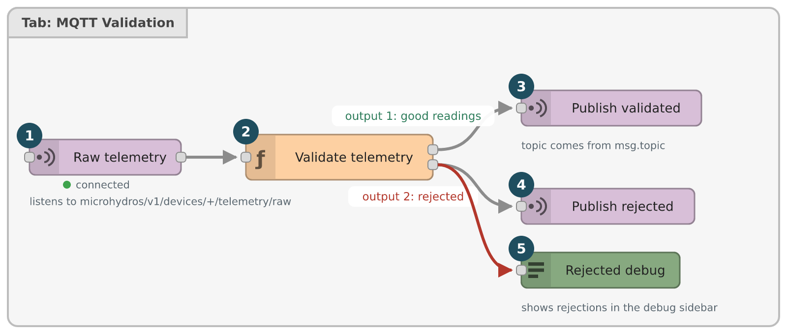

## 4.1 The nodes

| # | Node | Type | Important settings |
|---|---|---|---|
| 1 | Raw telemetry | mqtt in | Topic `microhydros/v1/devices/+/telemetry/raw`, QoS 1, output *auto-detect*, server *Local Mosquitto* |
| 2 | Validate telemetry | function | **2 outputs**, code in appendix A |
| 3 | Publish validated | mqtt out | Topic empty (comes from `msg.topic`), QoS 1, retain false |
| 4 | Publish rejected | mqtt out | Same as above |
| 5 | Rejected debug | debug | Shows rejected messages in the sidebar |

**Wires:** 1 to 2. Output 1 of 2 to 3. Output 2 of 2 to **both** 4 and 5.

Why the topic is empty on the mqtt out nodes: the function sets `msg.topic` for every message it creates, so each one lands on its own topic. An mqtt out node with an empty topic simply uses the message's topic.

## 4.2 What the function does, in order

1. **Parse.** Empty payload or broken JSON is rejected (`empty_payload`, `invalid_json`).
2. **Check the envelope.** `device_id` must exist and equal the device in the topic, `schema_version` must be 1, `boot_id` a non-empty string, `sequence` and `uptime_ms` non-negative integers, and both `measurements` and `sensor_status` must be objects.
3. **Drop duplicates.** The last `boot_id` and `sequence` per device is kept in `flow` memory under the key `last_seq_<device>`. A message with the same boot and a sequence that is not larger is dropped silently. MQTT QoS 1 may deliver a message twice, and this stops the second copy.
4. **One timestamp** for the whole cycle, so the four sensors of one reading share the same time.
5. **Check every sensor on its own.** One bad sensor does not stop the others.
6. **Send** the good ones to output 1 and the bad ones to output 2.

A function node can send **several messages at once** by returning an *array inside the array*: `[[m1, m2, m3], [r1]]` means "three messages on output 1, one on output 2". That is how one raw message becomes up to four validated ones.

## 4.3 Reasons for rejection

| `reason_code` | Meaning |
|---|---|
| `empty_payload`, `invalid_json` | The message could not be read |
| `missing_metadata`, `invalid_metadata` | Envelope field missing or wrong type |
| `device_id_mismatch` | Payload says another device than the topic |
| `unsupported_schema` | `schema_version` is not 1 |
| `missing_measurement`, `missing_sensor_status` | A sensor block is incomplete |
| `invalid_sensor_status` | Status is not one of `ok`, `read_error`, `not_detected`, `invalid_value` |
| `sensor_read_error`, `sensor_not_detected`, `invalid_value` | The sensor reported a problem |
| `invalid_type` | Value is not a finite number |
| `out_of_plausible_range` | Value outside the table in section 2.2 |

A rejection is published to `.../telemetry/rejected` with the reason and the received value. Nothing is silently lost except duplicates.

## 4.4 Test it

Publish a raw message (needs the `mosquitto_clients` package; replace the host as needed):

```bash
mosquitto_pub -h localhost -p 1884 -q 1 \
  -t microhydros/v1/devices/test-01/telemetry/raw \
  -m '{"schema_version":1,"device_id":"test-01","boot_id":"b1","sequence":1,"uptime_ms":5000,
       "measurements":{"internal_temperature_c":22.5,"internal_humidity_percent":55,
                       "external_temperature_c":18.4,"water_temperature_c":20.7},
       "sensor_status":{"internal_sht31":"ok","external_ds18b20":"ok","water_ds18b20":"ok"}}'
```

Then listen on the other side:

```bash
mosquitto_sub -h localhost -p 1884 -v -t 'microhydros/v1/devices/test-01/telemetry/#'
```

You should see the raw message, then four `validated/...` messages. Send the same command again with the same `sequence` and nothing new appears (duplicate). Change `water_temperature_c` to `99` and you get a `rejected` message with `out_of_plausible_range`, while the other three sensors still pass.

---

# 5. Tab 2: InfluxDB storage

**Job:** every validated reading becomes one row in the database, so Grafana can draw history.

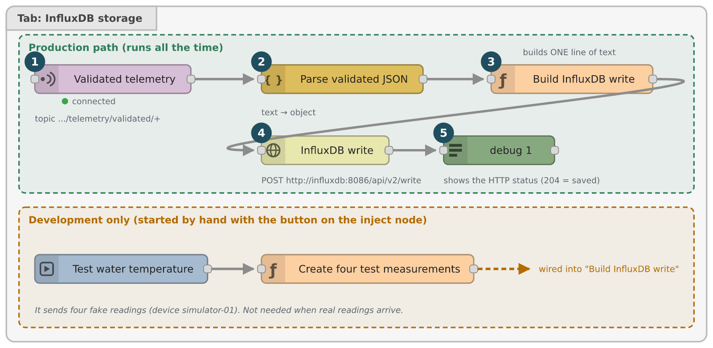

## 5.1 The nodes

| # | Node | Type | Important settings |
|---|---|---|---|
| 1 | Validated telemetry | mqtt in | Topic `microhydros/v1/devices/+/telemetry/validated/+`, QoS 1, *auto-detect* |
| 2 | Parse validated JSON | json | Turns the text into an object |
| 3 | Build InfluxDB write | function | 1 output, code in appendix B |
| 4 | InfluxDB write | http request | Method **use** (taken from `msg.method`), return *text* |
| 5 | debug 1 | debug | Shows InfluxDB's answer (an empty answer means success) |
| dev | Test water temperature | inject | Sends a timestamp when clicked |
| dev | Create four test measurements | function | Makes four fake readings |

The two *dev* nodes are only for testing without hardware. They sit in a group in the figure and can be left out.

**Wires:** 1 to 2 to 3 to 4 to 5. And for testing: inject to the test function to 3.

## 5.2 What "Build InfluxDB write" does

InfluxDB does not accept JSON. It wants *line protocol*, one line of text:

```
sensor_reading,device_id=esp32s3-01,measurement_type=water_temperature,sensor_id=water_ds18b20,unit=celsius value=24.7,schema_version=1i,sequence=1042i,uptime_ms=5000i,boot_id="b1" 1789887848000
```

| Part | Meaning |
|---|---|
| `sensor_reading` | The table name (measurement) |
| `device_id=...,measurement_type=...,sensor_id=...,unit=...` | **Tags**: things you filter and group by |
| `value=24.7,sequence=1042i,...` | **Fields**: the numbers stored (`i` marks an integer) |
| last number | Time in milliseconds |

The function first checks the reading (known measurement, finite value, parseable time), escapes special characters in tags, then sets four fields on the message **for the next node to use**:

| Field | Value |
|---|---|
| `msg.method` | `POST` |
| `msg.url` | `INFLUXDB_URL` + `/api/v2/write?org=...&bucket=...&precision=ms` |
| `msg.headers` | `Authorization: Token <INFLUXDB_TOKEN>` and the content type |
| `msg.payload` | The line above |

This is the pattern to remember: **the function builds the request, the http request node only sends it.** That is why the method is set to *use*: the node has no fixed address, it follows the message.

## 5.3 Test it

Click the blue square on the inject node, then look at the debug sidebar. An empty answer is success. To see the data, in the InfluxDB Data Explorer choose bucket `microhydros`, measurement `sensor_reading`, field `value`, and press submit.

> Data Explorer only: choose the field `value`. The other fields (`boot_id` is text) cannot be averaged and give an error such as "unsupported input type for mean aggregate: string".

---

# 6. Tab 3: LeafLimits

**Job:** know the healthy range for each plant, tell when a reading leaves it, and serve a small web app with an AI helper for setting the limits from a photo.

The tab is drawn in four sections, each headed by a comment node. The whole tab is **generated** from small source files (part 9), so the description below is what the generated flow contains: 39 items, 38 nodes plus the tab.

## 6.1 Section 1: evaluate readings

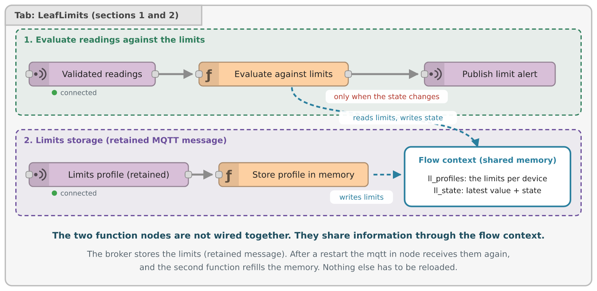

| # | Node | Type | Settings |
|---|---|---|---|
| 1 | Validated readings | mqtt in | Topic `.../telemetry/validated/+`, QoS 1 |
| 2 | Evaluate against limits | function | Source `src/evaluate.fn.js` |
| 3 | Publish limit alert | mqtt out | Topic from `msg.topic`, QoS 1 |

Wires: 1 to 2 to 3. The function returns `null` unless the state **changed**, so a steady reading sends nothing.

### The state machine

Every sensor of every device has one of these states.

| State | Meaning |
|---|---|
| `unknown` | No limits known, or the limits were just changed |
| `ok` | Inside the range |
| `low` | Below the minimum |
| `high` | Above the maximum |

To stop a single odd reading from triggering an alert, three constants decide:

| Constant | Value | Meaning |
|---|---|---|
| `ENTER_COUNT` | 3 | Three readings in a row out of range before `low`/`high` is raised (about 15 s at a 5 s interval) |
| `EXIT_COUNT` | 2 | Two readings in a row back inside before it returns to `ok` |
| `HYSTERESIS` | 0.02 | A value must move 2 % of the range back inside first, so a value hovering on the limit does not flicker |

The function keeps two things in `flow` memory: `ll_profiles` (the limits per device) and `ll_state` (the latest value and state per sensor). Alerts go to `microhydros/v1/devices/{id}/limits/alert` and look like this:

```json
{ "schema_version": 1, "device_id": "esp32s3-01", "measurement": "water_temperature",
  "state": "high", "previous_state": "ok", "value": 24.7, "unit": "celsius",
  "limit": { "min": 18, "max": 24 }, "timestamp": "2026-09-20T09:00:00.000Z" }
```

## 6.2 Section 2: limits storage

| # | Node | Type | Settings |
|---|---|---|---|
| 4 | Limits profile (retained) | mqtt in | Topic `microhydros/v1/devices/+/limits/config`, QoS 1 |
| 5 | Store profile in memory | function | Source `src/config-store.fn.js` |

Wire: 4 to 5. The function has **no output**; it writes the profile into `flow` memory `ll_profiles` and resets the sensor states of that device, because new limits mean a fresh start.

The clever part is that the durable copy of the limits is a **retained MQTT message** on the broker. When Node-RED restarts, the broker delivers that retained message again the moment this node subscribes, so the memory refills by itself. No database is needed for limits. An empty retained message deletes the profile.

## 6.3 Section 3: the HTTP API

The phone app talks to Node-RED through four routes.

| Method | Path | Answers with |
|---|---|---|
| GET | `/leaflimits/api/limits/:device` | The saved limits of one device |
| PUT | `/leaflimits/api/limits/:device` | Saves new limits (and publishes them retained) |
| GET | `/leaflimits/api/status/:device` | Latest value, unit, state and age of each sensor |
| POST | `/leaflimits/api/suggest` | Limits suggested by the AI from a plant photo |

`:device` in a path is a placeholder. Node-RED gives you the real value in `msg.req.params.device`.

### 6.3.1 How an HTTP request is handled

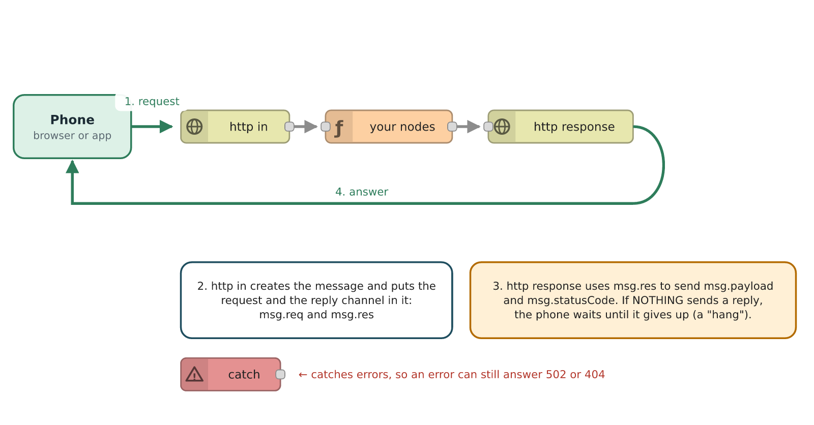

Three rules for every API route:

1. It **starts** with an **http in** node.
2. It **ends** with an **http response** node. This is where the answer leaves.
3. The **message must keep `msg.res`** all the way. Only that reply channel lets http response answer the right phone. If a function builds a brand-new message and forgets to copy it, no answer is sent and the phone waits until it gives up.

Also: if **nothing** replies, the request hangs. That is why each route ends in a Reply node on every path, including errors.

### 6.3.2 The pattern used by every route

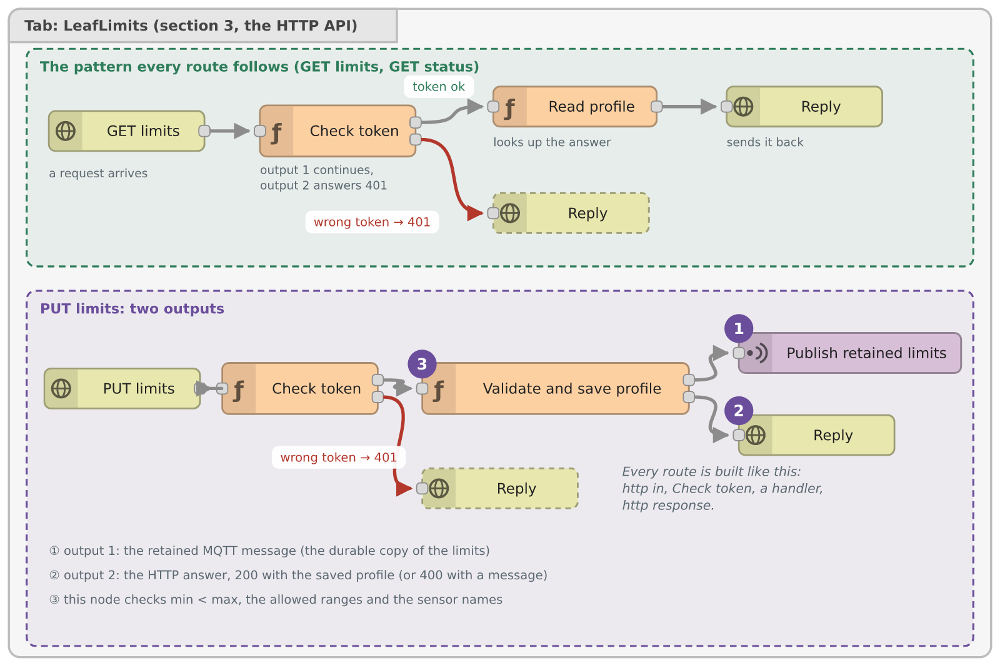

| Step | Node | What it does |
|---|---|---|
| a | http in | Receives the request |
| b | Check token | Two outputs: output 1 continues, output 2 is a `401` reply |
| c | Handler function | Does the work |
| d | Reply | http response, sends `msg.payload` with `msg.statusCode` |

**Check token** (`src/auth.fn.js`) compares the header `Authorization: Bearer <token>` with the tab setting `LEAFLIMITS_TOKEN`. Without the right token no route works.

The PUT route has a handler with **two outputs**: output 1 publishes the limits as a retained MQTT message (mqtt out *Publish retained limits*, topic `.../limits/config`), output 2 is the reply. So one save changes memory immediately, stores the durable copy on the broker, and answers the phone.

Every route's handler answers through one helper, `LL.reply(msg, status, body)`. It sets `msg.statusCode` and `msg.payload` and returns the message. All error paths therefore look the same to the app.

### 6.3.3 Try the routes

```bash
TOKEN=...   # the value of LEAFLIMITS_TOKEN, never paste it into a chat or a file in git
curl -s -H "Authorization: Bearer $TOKEN" http://localhost:1881/leaflimits/api/status/esp32s3-01

curl -s -X PUT -H "Authorization: Bearer $TOKEN" -H "Content-Type: application/json" \
  -d '{"plant":"Basil","limits":{"water_temperature":{"min":18,"max":24}}}' \
  http://localhost:1881/leaflimits/api/limits/esp32s3-01
```

Without the header you get `401`. A device id with strange characters gets `400`.

## 6.4 The AI suggestion route

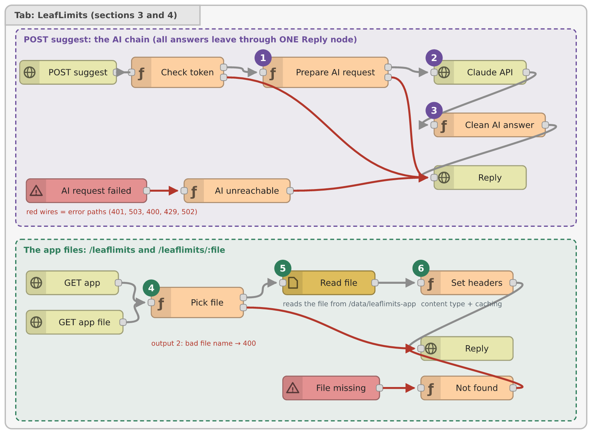

`POST /leaflimits/api/suggest` is the longest chain.

| # | Node | Type | What it does |
|---|---|---|---|
| a | POST suggest | http in | Receives the photo (as text) |
| b | Check token | function | Same as before |
| c | Prepare AI request | function, 2 outputs | Enforces the hourly limit (20), builds the request for Claude, or answers `429` |
| d | Claude API | http request | Method *use*; sends the request to the AI service |
| e | Clean AI answer | function | Takes the AI's text apart, keeps only valid limits and clamps them into the hard ranges |
| f | Reply | http response | Answers the phone |
| g | AI request failed | catch | Receives network errors from the http request node |
| h | AI unreachable | function | Turns the error into a `502` reply |

The request that "Prepare AI request" builds goes to `ANTHROPIC_API_URL` with the headers `x-api-key` (from `ANTHROPIC_API_KEY`) and `anthropic-version`, the model from `ANTHROPIC_MODEL`, and a fixed instruction that asks for limits as JSON. **The key stays inside Node-RED.** The phone never sees it.

**Why a catch node?** If the network is down, the http request node throws an error and the message never arrives at "Clean AI answer". A *catch* node collects such errors so you can still answer the phone with a clear message.

**Why "Clean AI answer" checks everything:** the AI is a text generator. Its answer can be wrong, incomplete, or outside what the sensors can measure. The function drops invalid entries and clamps the rest into the hard ranges of section 2.2. The app then shows them as suggestions the user can accept or edit.

## 6.5 Section 4: serving the web app

Also in the figure above (lower chain): two routes, `GET /leaflimits` and `GET /leaflimits/:file`, both go to the function **Pick file**.

| # | Node | Type | What it does |
|---|---|---|---|
| 1 | GET app, GET app file | http in | Two entry points, same handler |
| 2 | Pick file | function, 2 outputs | Validates the file name (letters, digits, dot, dash, underscore only, no `..`), builds the path in `LEAFLIMITS_APP_DIR` |
| 3 | Read file | file in | Reads the file as a binary buffer (so images work too) |
| 4 | Set headers | function | Sets `Content-Type`, caching and safety headers from the file extension; unknown types get `404` |
| 5 | Reply | http response | Sends the file |
| 6 | File missing | catch | Catches the "file not found" error |
| 7 | Not found | function | Replies `404` |

Only files directly in the app folder can be reached, so nobody can read `/etc/passwd` by asking for `../../etc/passwd`.

The app itself (an Angular build) is copied to `/data/leaflimits-app` in the Node-RED container. It is served without a token, the API is not.

---

# 7. How the tabs work together

## 7.1 The life of one reading

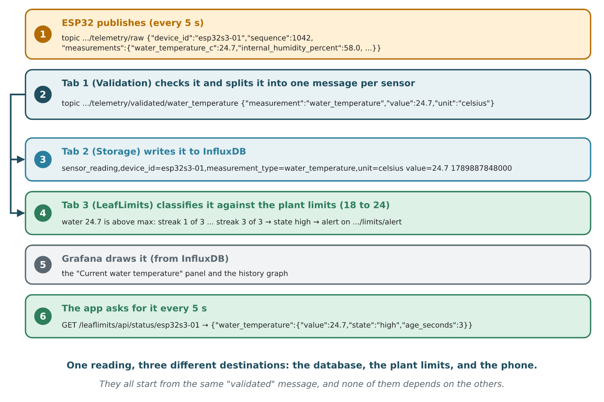

Follow one value from a probe to a phone:

1. The ESP32 publishes a raw JSON message every five seconds.
2. Tab 1 checks it and publishes up to four **validated** messages, one per sensor.
3. Tab 2 and tab 3 both subscribe to validated messages. Each gets its own copy. Tab 2 stores it in InfluxDB, tab 3 updates its state and maybe raises an alert.
4. Grafana reads InfluxDB. The app reads tab 3's memory through `GET /status/:device`.

Because tabs 2 and 3 only receive a copy of the same message, **they cannot break each other**. If InfluxDB is down, tab 3 still classifies. If tab 3 is disabled, the database still fills.

## 7.2 What depends on what

| If this is off or broken | Then this stops | And this still works |
|---|---|---|
| ESP32 offline | Everything, no new data | Old data in Grafana, saved limits, the app's Settings |
| Tab 1 (validation) | Storage, alerts, live status (no validated data) | Editing limits in the app |
| Tab 2 (storage) | New history in Grafana | Alerts, live status in the app |
| Tab 3 (LeafLimits) | Alerts, the app and its API | Data collection and Grafana |
| Mosquitto | Everything that travels over MQTT: new data, storage, alerts, saving limits | Serving the app files, Grafana history |
| InfluxDB | History and Grafana | Alerts and the app |
| Claude API / key | Only "Get suggested limits" | Entering limits by hand |

## 7.3 Where does each piece of memory live?

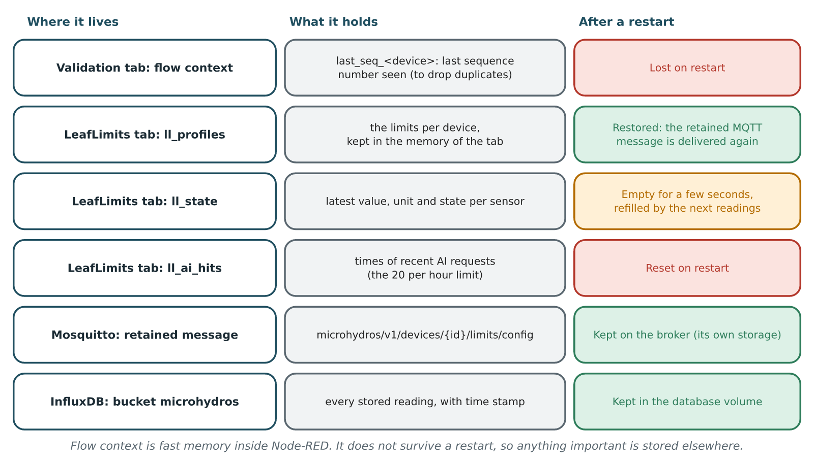

The rule: **flow context is fast but forgets on restart**. Anything that must survive is stored elsewhere: limits in a retained message, readings in InfluxDB. The alert state is rebuilt from the next few readings.

## 7.4 Safe ways to switch things off

| Goal | How | Effect on the other tabs |
|---|---|---|
| Pause the LeafLimits tab | Double-click the tab, tick *Disabled*, Deploy | None |
| Pause storage | Same on the storage tab | None |
| Pause validation | Same on tab 1 | 2 and 3 will get no data |
| Remove LeafLimits completely | Delete the tab, Deploy | None. The retained limits stay on the broker |

When you deploy, choose **Modified Flows** in the Deploy button's menu: only what changed is restarted. With *Full* deploy every node is restarted, including the MQTT connection.

---

# 8. Configuration and secrets

Node-RED nodes should never contain passwords in their code. Use *environment variables*: `env.get('NAME')` looks a value up in this order.

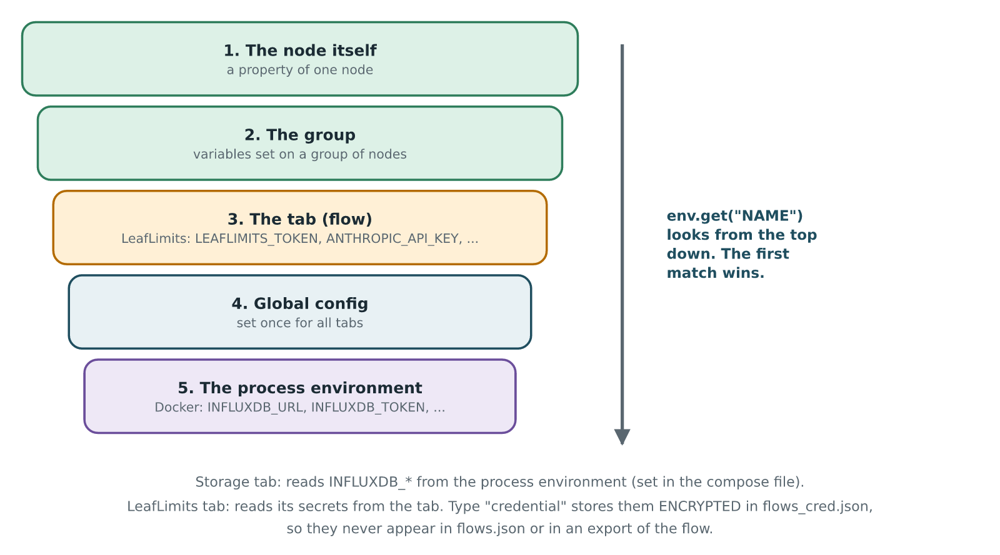

| Setting | Where it is set | Used by |
|---|---|---|
| `INFLUXDB_URL`, `INFLUXDB_ORG`, `INFLUXDB_BUCKET`, `INFLUXDB_TOKEN` | Docker: process environment (compose file and `.env`) | Tab 2 |
| `LEAFLIMITS_TOKEN` | Tab environment, type **credential** | Check token |
| `ANTHROPIC_API_KEY` | Tab environment, type **credential** | Prepare AI request |
| `ANTHROPIC_MODEL` | Tab environment | Prepare AI request (default `claude-sonnet-5`) |
| `ANTHROPIC_API_URL` | Tab environment | Prepare AI request |
| `SUGGEST_MAX_PER_HOUR` | Tab environment | Prepare AI request (default 20) |
| `LEAFLIMITS_APP_DIR` | Tab environment | Pick file (default `/data/leaflimits-app`) |

**How to set a tab variable:** double-click the tab title, open the *Environment Variables* section, add a row. Choose **credential** for secrets: they are then stored encrypted in `flows_cred.json` next to `flows.json`, never in an export, and never in git.

> **Secrets checklist**
> - Never paste a key, token or password into a chat, a ticket or a commit.
> - The imported LeafLimits tab has *empty* credential slots. You fill them in the editor after import.
> - Back up `flows_cred.json` **and** the credential secret together. One without the other cannot be decrypted.
> - Access is over plain HTTP in this setup. Use HTTPS before this is more than a school demo.
> - The Anthropic key may have an expiry date. An expired key looks like a wrong key (`401`). Replace it in the tab settings.

---

# 9. The build pipeline of the LeafLimits tab

You could draw all 38 nodes by hand, but the function code would then live inside JSON strings, where it cannot be tested or reviewed. So the LeafLimits tab is **generated**.

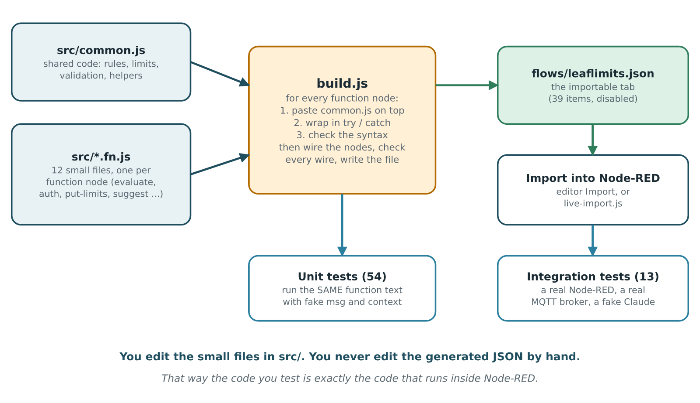

| File | Role |
|---|---|
| `docker/node-red/leaflimits/src/common.js` | Shared code: the `LL` object with limits, ranges, `classify`, `step`, `parseProfile`, `reply`, `auth` |
| `docker/node-red/leaflimits/src/*.fn.js` | One file per function node. |
| `docker/node-red/leaflimits/build.js` | Pastes `common.js` above each function, wraps it in try/catch, checks syntax, wires the nodes, checks every wire and writes the flow |
| `docker/node-red/flows/leaflimits.json` | The generated result. **Do not edit by hand.** |
| `docker/node-red/leaflimits/test/unit.test.js` | 54 tests. Run the same function text with a fake `msg`, `flow`, `env` |
| `docker/node-red/leaflimits/test/integration.test.js` | 13 tests. Real Node-RED and MQTT broker, fake Claude |

The workflow when you change something:

```bash
# 1. edit a file in docker/node-red/leaflimits/src/
# 2. rebuild the flow file
node docker/node-red/leaflimits/build.js
# 3. run the fast tests (no dependencies)
node --test docker/node-red/leaflimits/test/unit.test.js
# 4. import the tab into Node-RED (editor Import) and Deploy
```

Because the tests run the *same text* that Node-RED runs, a green test really means the deployed code works.

The built flow is marked **disabled**. That is on purpose: importing it never changes a running system until you enable it. Enable the tab, fill in the two credentials, and deploy.

---

# 10. Troubleshooting

| Symptom | Likely cause | What to do |
|---|---|---|
| Nothing happens after drawing | Not deployed | Press Deploy |
| A node shows a red triangle | A property is missing or invalid | Double-click it, read the error |
| mqtt node shows "disconnected" | Wrong broker name or port | The server must be `mosquitto`, port `1883`, inside Docker |
| No validated messages | Tab 1 disabled, or the ESP32 is offline | `mosquitto_sub -t 'microhydros/#' -v` shows what really arrives |
| Only some sensors validated | The others failed the checks | Look at `telemetry/rejected` for the reason code |
| Same reading appears once, then never | Duplicate filter (same `sequence`) | Test with a rising `sequence` or a new `boot_id` |
| InfluxDB write gives `401` | Wrong `INFLUXDB_TOKEN` | Check the Docker environment |
| InfluxDB write gives `404` | Wrong bucket or org name | Check `INFLUXDB_ORG` and `INFLUXDB_BUCKET` |
| Grafana shows no data | Storage tab disabled, or the time range is too short | Enable it, widen the time range |
| App or curl gets `401` | Missing or wrong bearer token | Compare with `LEAFLIMITS_TOKEN` |
| Request hangs, then times out | A route path has no Reply | Check that every output ends in an http response and that `msg.res` was kept |
| AI suggestion gives `429` | 20 requests per hour used | Wait, or raise `SUGGEST_MAX_PER_HOUR` |
| AI suggestion gives "key was rejected" | Expired or wrong key | Check the key and its expiry date |
| AI suggestion gives `502` | Server cannot reach the AI service | Check network and the URL |
| Limits vanish after a restart | The retained message was never published | Save the limits again in the app. Check with `mosquitto_sub -t 'microhydros/v1/devices/+/limits/config' -v` |
| The app shows a blank page | App files not in `LEAFLIMITS_APP_DIR` | Copy the build output to that folder |

Three debugging habits that solve most problems:

1. Put a **debug** node on any wire (green button, right side). It prints what travels there.
2. Use **`node.warn(...)`** inside a function to print your own values to the sidebar.
3. Use **`mosquitto_sub -v -t '#'`** to see everything the broker carries, independent of Node-RED.

---

# 11. Recipe: add a new sensor

As an example, a soil moisture sensor called `soil_moisture_percent` that should be validated, stored and given limits.

| Step | Where | What |
|---|---|---|
| 1 | ESP32 firmware | Add `soil_moisture_percent` to `measurements` and `soil_sensor` to `sensor_status` |
| 2 | Tab 1, function *Validate telemetry* | Add it to `PLAUSIBLE_RANGES` (0 to 100) and `MEASUREMENT_MAP` (`{ name: "soil_moisture", sensor: "soil_sensor", unit: "percent" }`) |
| 3 | Tab 2, function *Build InfluxDB write* | Add `"soil_moisture"` to `allowedMeasurements` |
| 4 | LeafLimits `src/common.js` | Add `soil_moisture: { label: 'Soil moisture', hardMin: 0, hardMax: 100 }` to `LL.MEASUREMENTS` |
| 5 | LeafLimits | Rebuild, run the tests, import, deploy (part 9) |
| 6 | App | Add the label and unit for the new key |

Steps 2 and 3 are done in the editor: double-click the function node, edit, Done, Deploy. Test with a raw message that contains the new field (part 4.4).

> The ranges in `PLAUSIBLE_RANGES` and in `LL.MEASUREMENTS` (hardMin/hardMax) must agree. Tab 1 is the outer wall and rejects anything beyond it. LeafLimits' hard ranges make sure a user can never set a limit the sensor cannot report.

---

# 12. Glossary

| Word | Meaning |
|---|---|
| **Broker** | The MQTT server (Mosquitto) that passes messages between programs |
| **Bucket** | A named storage area in InfluxDB |
| **Catch node** | A node that receives errors thrown by other nodes on the same tab |
| **Config node** | A node that holds shared settings, such as the broker connection |
| **Context** | Memory that lives longer than one message: node, flow, or global |
| **Credential** | A setting that Node-RED stores encrypted, for secrets |
| **Deploy** | Sending the drawing to the server so it starts running |
| **Flow** | A tab: nodes and wires that belong together |
| **Function node** | A node that runs your JavaScript |
| **Hysteresis** | A small dead zone that prevents a value on a limit from flickering |
| **InfluxDB** | The time-series database that stores the readings |
| **Line protocol** | InfluxDB's text format for one row |
| **Message (`msg`)** | The object that travels along the wires |
| **MQTT** | A light-weight publish/subscribe message protocol |
| **Node** | One box on the canvas |
| **Payload (`msg.payload`)** | The main data of a message |
| **QoS** | MQTT delivery level. QoS 1 means "at least once", so duplicates are possible |
| **Retained message** | A message the broker keeps and gives to each new subscriber |
| **Topic** | The address of an MQTT message, such as `microhydros/v1/devices/esp32s3-01/telemetry/raw` |
| **Wildcard `+`** | Matches exactly one level in a topic |
| **Wire** | A line from an output to an input |

---

# Appendix A: complete code of "Validate telemetry" (tab 1)

Copied from `docker/node-red/flows/mqtt-validation.json`. Paste it into the function node when building by hand (set the node to **2 outputs**).

```javascript
const SUPPORTED_SCHEMA_VERSION = 1;

const PLAUSIBLE_RANGES = {
    internal_temperature_c: [-10.0, 60.0],
    internal_humidity_percent: [0.0, 100.0],
    external_temperature_c: [-40.0, 60.0],
    water_temperature_c: [0.0, 50.0]
};

const MEASUREMENT_MAP = {
    internal_temperature_c: { name: "internal_temperature", sensor: "internal_sht31", unit: "celsius" },
    internal_humidity_percent: { name: "internal_humidity", sensor: "internal_sht31", unit: "percent_rh" },
    external_temperature_c: { name: "external_temperature", sensor: "external_ds18b20", unit: "celsius" },
    water_temperature_c: { name: "water_temperature", sensor: "water_ds18b20", unit: "celsius" }
};

const VALID_SENSOR_STATUSES = ["ok", "read_error", "not_detected", "invalid_value"];

function extractDeviceIdFromTopic(topic) {
    const parts = topic.split("/");
    return parts.length >= 4 ? parts[3] : null;
}

function rejectMessage(deviceId, reasonCode, description) {
    return {
        topic: `microhydros/v1/devices/${deviceId || "unknown"}/telemetry/rejected`,
        payload: {
            schema_version: SUPPORTED_SCHEMA_VERSION,
            device_id: deviceId || null,
            timestamp: new Date().toISOString(),
            rejection_scope: "message",
            reason_code: reasonCode,
            description
        }
    };
}

function rejectMeasurement(raw, timestamp, field, sensorId, receivedValue, reasonCode, description) {
    const mapping = MEASUREMENT_MAP[field];
    return {
        topic: `microhydros/v1/devices/${raw.device_id}/telemetry/rejected`,
        payload: {
            schema_version: SUPPORTED_SCHEMA_VERSION,
            device_id: raw.device_id,
            boot_id: raw.boot_id,
            sequence: raw.sequence,
            timestamp,
            rejection_scope: "measurement",
            measurement: mapping ? mapping.name : field,
            sensor_id: sensorId,
            received_value: receivedValue,
            reason_code: reasonCode,
            description
        }
    };
}

// ---- 1. Parse payload ----
const topicDeviceId = extractDeviceIdFromTopic(msg.topic);

if (msg.payload === undefined || msg.payload === null || msg.payload === "") {
    return [null, [rejectMessage(topicDeviceId, "empty_payload", "The MQTT payload was empty")]];
}

let raw;
try {
    raw = typeof msg.payload === "string" ? JSON.parse(msg.payload) : msg.payload;
} catch (e) {
    return [null, [rejectMessage(topicDeviceId, "invalid_json", "The raw MQTT payload could not be parsed as JSON")]];
}

if (typeof raw !== "object" || raw === null || Array.isArray(raw)) {
    return [null, [rejectMessage(topicDeviceId, "invalid_json", "Payload is valid JSON but not a JSON object")]];
}

// ---- 2. Validate common metadata ----
if (typeof raw.device_id !== "string" || raw.device_id.length === 0) {
    return [null, [rejectMessage(topicDeviceId, "missing_metadata", "device_id is missing or invalid")]];
}
if (raw.device_id !== topicDeviceId) {
    return [null, [rejectMessage(topicDeviceId, "device_id_mismatch", `Payload device_id "${raw.device_id}" does not match topic device_id "${topicDeviceId}"`)]];
}
if (raw.schema_version !== SUPPORTED_SCHEMA_VERSION) {
    return [null, [rejectMessage(raw.device_id, "unsupported_schema", `schema_version ${raw.schema_version} is not supported`)]];
}
if (typeof raw.boot_id !== "string" || raw.boot_id.length === 0) {
    return [null, [rejectMessage(raw.device_id, "missing_metadata", "boot_id is missing or invalid")]];
}
if (!Number.isInteger(raw.sequence) || raw.sequence < 0) {
    return [null, [rejectMessage(raw.device_id, "invalid_metadata", "sequence is missing or not a non-negative integer")]];
}
if (!Number.isInteger(raw.uptime_ms) || raw.uptime_ms < 0) {
    return [null, [rejectMessage(raw.device_id, "invalid_metadata", "uptime_ms is missing or not a non-negative integer")]];
}
if (typeof raw.measurements !== "object" || raw.measurements === null) {
    return [null, [rejectMessage(raw.device_id, "missing_metadata", "measurements object is missing")]];
}
if (typeof raw.sensor_status !== "object" || raw.sensor_status === null) {
    return [null, [rejectMessage(raw.device_id, "missing_metadata", "sensor_status object is missing")]];
}

// ---- 3. Deduplicate ----
const dedupKey = `last_seq_${raw.device_id}`;
const lastSeen = flow.get(dedupKey);

if (lastSeen && lastSeen.boot_id === raw.boot_id && raw.sequence <= lastSeen.sequence) {
    node.debug(`Dropped duplicate/redelivered message: device=${raw.device_id} boot_id=${raw.boot_id} sequence=${raw.sequence} (already processed up to ${lastSeen.sequence})`);
    return [null, null];
}

flow.set(dedupKey, { boot_id: raw.boot_id, sequence: raw.sequence });

// ---- 4. One timestamp for the whole cycle ----
const timestamp = new Date().toISOString();

// ---- 5. Validate each measurement independently ----
const validated = [];
const rejected = [];

for (const [field, mapping] of Object.entries(MEASUREMENT_MAP)) {
    const inMeasurements = field in raw.measurements;
    const value = raw.measurements[field];
    const sensorStatus = raw.sensor_status[mapping.sensor];

    if (!inMeasurements) {
        rejected.push(rejectMeasurement(raw, timestamp, field, mapping.sensor, undefined, "missing_measurement", `${field} is missing from measurements`));
        continue;
    }
    if (sensorStatus === undefined) {
        rejected.push(rejectMeasurement(raw, timestamp, field, mapping.sensor, value, "missing_sensor_status", `sensor_status for ${mapping.sensor} is missing`));
        continue;
    }
    if (!VALID_SENSOR_STATUSES.includes(sensorStatus)) {
        rejected.push(rejectMeasurement(raw, timestamp, field, mapping.sensor, value, "invalid_sensor_status", `sensor_status "${sensorStatus}" is not a supported value`));
        continue;
    }
    if (sensorStatus !== "ok") {
        const reasonCode = sensorStatus === "read_error" ? "sensor_read_error"
            : sensorStatus === "not_detected" ? "sensor_not_detected"
                : "invalid_value";
        rejected.push(rejectMeasurement(raw, timestamp, field, mapping.sensor, value, reasonCode, `Sensor status is "${sensorStatus}"`));
        continue;
    }

    if (value === null) {
        rejected.push(rejectMeasurement(raw, timestamp, field, mapping.sensor, value, "invalid_value", `${field} is null despite sensor_status "ok" — contradictory input`));
        continue;
    }
    if (typeof value !== "number" || !Number.isFinite(value)) {
        rejected.push(rejectMeasurement(raw, timestamp, field, mapping.sensor, value, "invalid_type", `${field} is not a finite number`));
        continue;
    }

    const [min, max] = PLAUSIBLE_RANGES[field];
    if (value < min || value > max) {
        rejected.push(rejectMeasurement(raw, timestamp, field, mapping.sensor, value, "out_of_plausible_range", `${field}=${value} is outside [${min}, ${max}]`));
        continue;
    }

    validated.push({
        topic: `microhydros/v1/devices/${raw.device_id}/telemetry/validated/${mapping.name}`,
        payload: {
            schema_version: SUPPORTED_SCHEMA_VERSION,
            device_id: raw.device_id,
            boot_id: raw.boot_id,
            sequence: raw.sequence,
            uptime_ms: raw.uptime_ms,
            timestamp,
            measurement: mapping.name,
            value,
            unit: mapping.unit,
            sensor_id: mapping.sensor
        }
    });
}

return [validated.length ? validated : null, rejected.length ? rejected : null];
```

# Appendix B: complete code of "Build InfluxDB write" (tab 2)

Copied from `docker/node-red/flows/influxdb-storage.json`. Paste it into the function node when building by hand (1 output). It reads `INFLUXDB_URL`, `INFLUXDB_ORG`, `INFLUXDB_BUCKET` and `INFLUXDB_TOKEN` from the environment.

```javascript
const reading = msg.payload;

const allowedMeasurements = [
    "internal_temperature",
    "internal_humidity",
    "external_temperature",
    "water_temperature"
];

if (!allowedMeasurements.includes(reading.measurement)) {
    node.error("Unsupported measurement type", msg);
    return null;
}

if (!Number.isFinite(reading.value)) {
    node.error("Measurement value is not finite", msg);
    return null;
}

const timestamp = Date.parse(reading.timestamp);

if (!Number.isFinite(timestamp)) {
    node.error("Invalid timestamp", msg);
    return null;
}

function escapeTag(value) {
    return String(value)
        .replace(/\\/g, "\\\\")
        .replace(/ /g, "\\ ")
        .replace(/,/g, "\\,")
        .replace(/=/g, "\\=");
}

function escapeString(value) {
    return String(value)
        .replace(/\\/g, "\\\\")
        .replace(/"/g, '\\"');
}

msg.method = "POST";
msg.url =
    `${env.get("INFLUXDB_URL")}/api/v2/write` +
    `?org=${encodeURIComponent(env.get("INFLUXDB_ORG"))}` +
    `&bucket=${encodeURIComponent(env.get("INFLUXDB_BUCKET"))}` +
    `&precision=ms`;

msg.headers = {
    Authorization: `Token ${env.get("INFLUXDB_TOKEN")}`,
    "Content-Type": "text/plain; charset=utf-8"
};

msg.payload =
    `sensor_reading` +
    `,device_id=${escapeTag(reading.device_id)}` +
    `,measurement_type=${escapeTag(reading.measurement)}` +
    `,sensor_id=${escapeTag(reading.sensor_id)}` +
    `,unit=${escapeTag(reading.unit)}` +
    ` value=${reading.value}` +
    `,schema_version=${reading.schema_version}i` +
    `,sequence=${reading.sequence}i` +
    `,uptime_ms=${reading.uptime_ms}i` +
    `,boot_id="${escapeString(reading.boot_id)}"` +
    ` ${timestamp}`;

return msg;
```

# Appendix C: the code of the LeafLimits functions

The LeafLimits functions are not repeated here because they are generated from real files that change. Read them in `docker/node-red/leaflimits/src/`:

| File | Node |
|---|---|
| `evaluate.fn.js` | Evaluate against limits |
| `config-store.fn.js` | Store profile in memory |
| `auth.fn.js` | Check token |
| `get-limits.fn.js` | Read profile |
| `put-limits.fn.js` | Validate and save profile |
| `get-status.fn.js` | Latest values and state |
| `suggest-prepare.fn.js` | Prepare AI request |
| `suggest-parse.fn.js` | Clean AI answer |
| `suggest-error.fn.js` | AI unreachable |
| `static-request.fn.js` | Pick file |
| `static-response.fn.js` | Set headers |
| `static-missing.fn.js` | Not found |
