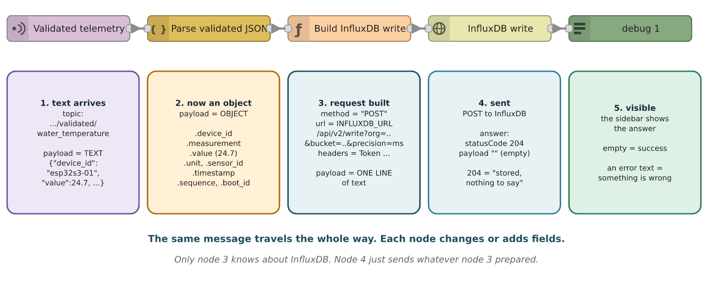
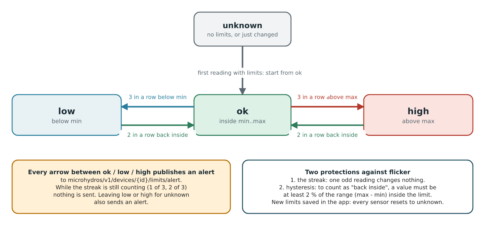
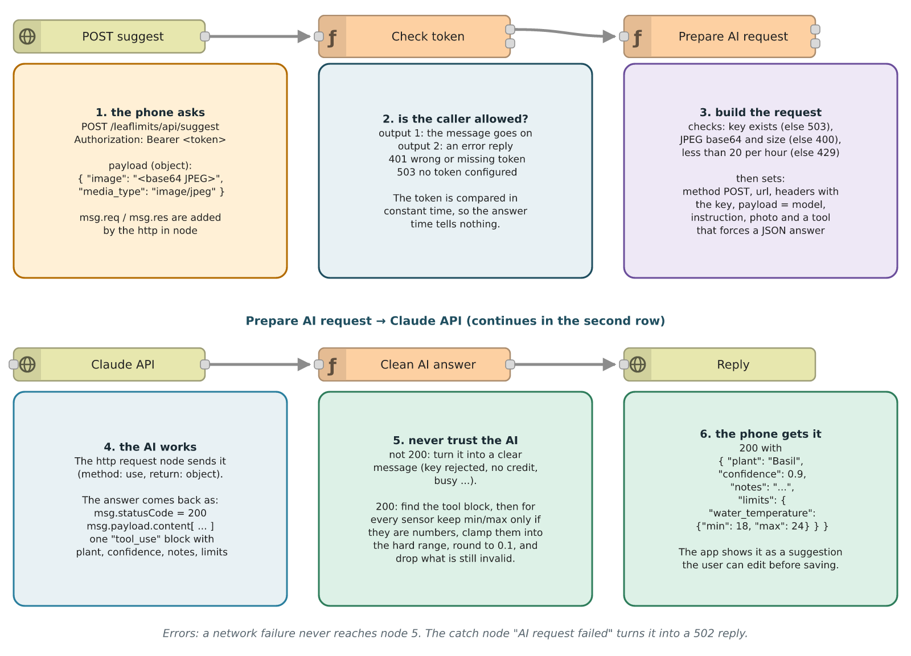

# MicroHydros Node-RED flows: a beginner's guide

How the three Node-RED tabs of MicroHydros are built, node by node, and how they work together.

**Who this is for:** you know roughly what a sensor and a web page are, but you have never opened Node-RED. After this guide you can read the flows, rebuild them by hand, test each step, and change them safely.

**How to read it:** part 1 teaches Node-RED itself. Parts 2 to 6 walk through the flows. Parts 7 to 11 explain how the pieces cooperate, where secrets live, how to rebuild the generated flow, what to do when something breaks, and how to add a sensor.

> The files in the repository are the truth. This guide explains them. If the guide and a file ever disagree, the file wins: `docker/node-red/flows/*.json` and `docker/node-red/leaflimits/src/*.js`.

| Part | Content |
|---|---|
| 1 | Node-RED in ten minutes |
| 2 | The big picture: three tabs, one broker |
| 3 | Before you start: two ways to get the flows |
| 4 | Tab 1: MQTT Validation |
| 5 | Tab 2: InfluxDB storage (step by step, in detail) |
| 6 | Tab 3: LeafLimits (step by step, in detail) |
| 7 | How the tabs work together |
| 8 | Configuration and secrets |
| 9 | The build pipeline of the LeafLimits tab |
| 10 | Troubleshooting |
| 11 | Recipe: add a new sensor |
| 12 | Glossary |
| A, B, C | Appendix: the complete code of every function |

---

# 1. Node-RED in ten minutes

Node-RED is a tool where you build programs by drawing. You drag boxes onto a canvas and connect them with lines. Each box does one small job. A line says "when you are done, hand your result to the next box".

## 1.1 The editor


| # | Part | What it is for |
|---|---|---|
| 1 | Tabs | One tab is one flow, a group of boxes that belong together. This project has three. |
| 2 | Palette | The list of available node types. Drag from here onto the canvas. |
| 3 | Canvas | The drawing area. Boxes are nodes, lines are wires. |
| 4 | Sidebar | Shows the properties of the selected node, the debug messages, and the context data. |
| 5 | Deploy button | Nothing you draw runs until you press it. It sends your drawing to the server. |

Two things trip up every beginner:

1. **Drawing is not running.** Until you press **Deploy**, the server still runs the old version.
2. **A tab can be disabled.** A disabled tab is drawn greyed out and does nothing, even when deployed.

## 1.2 The four words you must know

| Word | Meaning | Real-life comparison |
|---|---|---|
| **Node** | One box with one job | A worker at a station |
| **Wire** | A line from one node's output to another node's input | A conveyor belt between two stations |
| **Message (`msg`)** | The thing that travels along wires | The parcel on the belt |
| **Flow** | A tab with its nodes and wires | One production line |

## 1.3 What a node looks like

Nodes have a colour and an icon so you can recognise the type. The pictures in this guide copy that look.

| Node type | Colour | What it does | Used in this project for |
|---|---|---|---|
| **mqtt in** | purple | Waits for messages on an MQTT topic | Receiving sensor readings |
| **mqtt out** | purple | Publishes a message to an MQTT topic | Sending validated readings and alerts |
| **function** | orange | Runs your own JavaScript | Validation, alert logic, the API |
| **json** | yellow | Converts text to an object | Reading the validated message |
| **http request** | pale yellow with a globe | Calls a web address | Writing to InfluxDB, asking Claude |
| **http in** | pale yellow with a globe | Waits for a web request | The LeafLimits API and the app |
| **http response** | pale yellow with a globe | Sends the answer back to whoever asked | Ending every API route |
| **file in** | yellow | Reads a file from disk | Serving the web app files |
| **debug** | green | Prints the message in the sidebar | Watching what happens |
| **inject** | blue | Sends a message when you click it | Testing without hardware |
| **catch** | red | Receives errors from other nodes | Turning failures into replies |
| **comment** | grey text | A note on the canvas, does nothing | Section headings |

A node with a **small square on its left** has an input. A **square on its right** is an output. A function node can have several outputs, which lets it choose where the message goes next.

## 1.4 The message

Everything that moves between nodes is a JavaScript object called `msg`. The important field is `msg.payload`, the actual data. Other fields carry extra facts: `msg.topic` is the MQTT topic, `msg.statusCode` is a web status such as 200 or 404.


Each node can read the message, change it and pass it on. The figure shows a typical trip: **mqtt in** creates the message with the text that arrived, **json** turns the text into an object, a **function** node changes the fields, and **debug** shows the result.

## 1.5 The function node in five lines

A function node holds JavaScript. It receives `msg` and must `return` something.

```javascript
// return the message: it continues on the wire
msg.payload = msg.payload * 2;
return msg;

// return null: the message stops here (nothing is sent)
return null;

// two outputs: [goes-to-output-1, goes-to-output-2], null means "nothing on this one"
return [msg, null];
```

Four things are always available inside a function node:

| Name | What it is | Example |
|---|---|---|
| `msg` | The incoming message | `msg.payload` |
| `flow` | Memory shared by every node in the same tab | `flow.set('x', 1)`, `flow.get('x')` |
| `global` | Memory shared by all tabs | `global.get('x')` |
| `env` | Settings and secrets (section 8) | `env.get('INFLUXDB_URL')` |
| `node` | The node itself, for logging | `node.warn('careful')`, `node.error('failed')` |

## 1.6 Import and export

A whole tab is stored as **JSON text**: a list with one entry per node, with its position, its properties and its wires (the ids of the next nodes). That is what you find in `docker/node-red/flows/*.json`. In the editor use the menu (top right) and choose **Import** to load such a file and **Export** to save one. Nothing is lost in the round trip, which is why the repository stores flows as JSON.

---

# 2. The big picture


The system is a chain of small programs that never call each other directly. They only **publish** and **subscribe** to topics on the MQTT broker (Mosquitto). This is called *publish/subscribe*: the sender does not know who listens, and the listener does not know who sent.

| Tab | Listens to | Does | Publishes / writes |
|---|---|---|---|
| **1. MQTT Validation** | `microhydros/v1/devices/+/telemetry/raw` | Checks every raw message, splits it into one message per sensor | `.../telemetry/validated/<sensor>` and `.../telemetry/rejected` |
| **2. InfluxDB storage** | `.../telemetry/validated/+` | Turns each reading into InfluxDB text and posts it | The database (bucket `microhydros`) |
| **3. LeafLimits** | `.../telemetry/validated/+` and `.../limits/config` | Compares readings with plant limits, offers a web API and the phone app | `.../limits/alert`, `.../limits/config` (retained) |

The `+` in a topic is a wildcard for exactly one level, so `devices/+/telemetry/raw` matches every device.

**The one rule that keeps this simple:** tab 1 is the only one that reads raw data. Tabs 2 and 3 only read the *validated* topic. If the validation tab were off, tabs 2 and 3 would just sit there waiting.

## 2.1 The topics used

| Topic | Who publishes | Who listens | Retained? |
|---|---|---|---|
| `microhydros/v1/devices/{id}/telemetry/raw` | The ESP32 | Tab 1 | no |
| `microhydros/v1/devices/{id}/telemetry/validated/{measurement}` | Tab 1 | Tabs 2 and 3 | no |
| `microhydros/v1/devices/{id}/telemetry/rejected` | Tab 1 | Nobody yet (kept for debugging) | no |
| `microhydros/v1/devices/{id}/limits/config` | Tab 3 (API save) | Tab 3 | **yes** |
| `microhydros/v1/devices/{id}/limits/alert` | Tab 3 | Anyone (future) | no |

*Retained* means the broker keeps the last message on that topic and hands it to every new subscriber immediately. Tab 3 uses that as its database for the limits (section 6.4).

## 2.2 The measurements

| Field in the ESP32 message | Measurement name | Sensor | Unit | Accepted range |
|---|---|---|---|---|
| `internal_temperature_c` | `internal_temperature` | `internal_sht31` | celsius | -10 to 60 |
| `internal_humidity_percent` | `internal_humidity` | `internal_sht31` | percent_rh | 0 to 100 |
| `external_temperature_c` | `external_temperature` | `external_ds18b20` | celsius | -40 to 60 |
| `water_temperature_c` | `water_temperature` | `water_ds18b20` | celsius | 0 to 50 |

---

# 3. Before you start

## 3.1 What is already running

The project runs in Docker on a server. The Node-RED container reaches the broker under the name `mosquitto` (port 1883 inside Docker; the outside world uses 1884). Node-RED itself is served on port 1881, InfluxDB on 8087 and Grafana on 3002.

## 3.2 Two ways to get the flows

| | A. Import (recommended) | B. Build by hand (to learn) |
|---|---|---|
| How | Editor menu, Import, paste the JSON file | Follow parts 4 to 6 and draw every node |
| Time | 2 minutes | 1 to 2 hours |
| Files | `mqtt-validation.json`, `influxdb-storage.json`, `leaflimits.json` | Same content, typed in |
| Good for | Getting a working system | Understanding it |

Even if you import, read parts 4 to 6. They explain why each node is there.

## 3.3 The shared broker connection

Every mqtt node points at one **configuration node** named *Local Mosquitto* (host `mosquitto`, port 1883). It does not appear on the canvas. It is created once and shared, so all tabs use **one** connection. Create it the first time you add an mqtt node: click the pencil next to *Server*, set Server = `mosquitto`, Port = `1883`, and add.

> The three flow files all carry the same broker config node id (`6fcdce2f11ec0ec3`). That is deliberate: importing a file must reuse the existing connection instead of making a second one.

---

# 4. Tab 1: MQTT Validation

**Job:** take every raw message from the ESP32, throw away anything broken, and republish the good sensor values one by one.


## 4.1 The nodes

| # | Node | Type | Important settings |
|---|---|---|---|
| 1 | Raw telemetry | mqtt in | Topic `microhydros/v1/devices/+/telemetry/raw`, QoS 1, output *auto-detect*, server *Local Mosquitto* |
| 2 | Validate telemetry | function | **2 outputs**, code in appendix A |
| 3 | Publish validated | mqtt out | Topic empty (comes from `msg.topic`), QoS 1, retain false |
| 4 | Publish rejected | mqtt out | Same as above |
| 5 | Rejected debug | debug | Shows rejected messages in the sidebar |

**Wires:** 1 to 2. Output 1 of 2 to 3. Output 2 of 2 to **both** 4 and 5.

Why the topic is empty on the mqtt out nodes: the function sets `msg.topic` for every message it creates, so each one lands on its own topic. An mqtt out node with an empty topic simply uses the message's topic.

## 4.2 What the function does, in order

1. **Parse.** Empty payload or broken JSON is rejected (`empty_payload`, `invalid_json`).
2. **Check the envelope.** `device_id` must exist and equal the device in the topic, `schema_version` must be 1, `boot_id` a non-empty string, `sequence` and `uptime_ms` non-negative integers, and both `measurements` and `sensor_status` must be objects.
3. **Drop duplicates.** The last `boot_id` and `sequence` per device is kept in `flow` memory under the key `last_seq_<device>`. A message with the same boot and a sequence that is not larger is dropped silently. MQTT QoS 1 may deliver a message twice, and this stops the second copy.
4. **One timestamp** for the whole cycle, so the four sensors of one reading share the same time.
5. **Check every sensor on its own.** One bad sensor does not stop the others.
6. **Send** the good ones to output 1 and the bad ones to output 2.

A function node can send **several messages at once** by returning an *array inside the array*: `[[m1, m2, m3], [r1]]` means "three messages on output 1, one on output 2". That is how one raw message becomes up to four validated ones.

## 4.3 Reasons for rejection

| `reason_code` | Meaning |
|---|---|
| `empty_payload`, `invalid_json` | The message could not be read |
| `missing_metadata`, `invalid_metadata` | Envelope field missing or wrong type |
| `device_id_mismatch` | Payload says another device than the topic |
| `unsupported_schema` | `schema_version` is not 1 |
| `missing_measurement`, `missing_sensor_status` | A sensor block is incomplete |
| `invalid_sensor_status` | Status is not one of `ok`, `read_error`, `not_detected`, `invalid_value` |
| `sensor_read_error`, `sensor_not_detected`, `invalid_value` | The sensor reported a problem |
| `invalid_type` | Value is not a finite number |
| `out_of_plausible_range` | Value outside the table in section 2.2 |

A rejection is published to `.../telemetry/rejected` with the reason and the received value. Nothing is silently lost except duplicates.

## 4.4 Test it

Publish a raw message (needs the `mosquitto_clients` package; replace the host as needed):

```bash
mosquitto_pub -h localhost -p 1884 -q 1 \
  -t microhydros/v1/devices/test-01/telemetry/raw \
  -m '{"schema_version":1,"device_id":"test-01","boot_id":"b1","sequence":1,"uptime_ms":5000,
       "measurements":{"internal_temperature_c":22.5,"internal_humidity_percent":55,
                       "external_temperature_c":18.4,"water_temperature_c":20.7},
       "sensor_status":{"internal_sht31":"ok","external_ds18b20":"ok","water_ds18b20":"ok"}}'
```

Then listen on the other side:

```bash
mosquitto_sub -h localhost -p 1884 -v -t 'microhydros/v1/devices/test-01/telemetry/#'
```

You should see the raw message, then four `validated/...` messages. Send the same command again with the same `sequence` and nothing new appears (duplicate). Change `water_temperature_c` to `99` and you get a `rejected` message with `out_of_plausible_range`, while the other three sensors still pass.

---

# 5. Tab 2: InfluxDB storage (step by step)

**Job:** every validated reading becomes one row in the database, so Grafana can draw history. This tab is small (five nodes), but it teaches the most important Node-RED pattern: *build a request in a function, send it with a generic node*. Read it slowly.


## 5.1 What you need to know about InfluxDB first

InfluxDB is a database made for measurements over time. Every stored value has a time stamp. These words appear in the flow:

| Word | Meaning | In this project |
|---|---|---|
| **Organisation (org)** | The owner of the data, like a company account | `INFLUXDB_ORG` |
| **Bucket** | A named storage area with a retention rule, like a database | `INFLUXDB_BUCKET` (`microhydros`) |
| **Token** | The password of the API. Anyone with the token can write | `INFLUXDB_TOKEN` |
| **Measurement** | A "table name" | always `sensor_reading` |
| **Tag** | A label you filter by. Indexed, always text | `device_id`, `measurement_type`, `sensor_id`, `unit` |
| **Field** | The actual value stored | `value` (a decimal number) plus `schema_version`, `sequence`, `uptime_ms`, `boot_id` |
| **Time stamp** | When the reading was taken | milliseconds since 1970 |
| **Point** | One row: measurement + tags + fields + time stamp | one sensor reading |

A **series** is one unique combination of measurement and tags. For example `sensor_reading` with `device_id=esp32s3-01` and `measurement_type=water_temperature` is one series, and its points form the line in a graph. If you write a point with the same series **and** the same time stamp twice, the second one overwrites the first. That makes accidental repeats harmless.

**Tags or fields?** Values you filter or group by (which device, which sensor) are tags. Values you calculate with (24.7) are fields. Putting the temperature in a tag would break every graph.

The four settings the flow needs come from the Docker environment of the Node-RED container (`docker/compose.yaml`). `INFLUXDB_URL` is `http://influxdb:8086`, which is the name of the InfluxDB container inside the Docker network (the outside port 8087 is only for you). The other three come from the `.env` file next to the compose file, the same values InfluxDB was created with. You never type them into a node.

## 5.2 How the message changes on the way



| After node | `msg.payload` | What else is on `msg` |
|---|---|---|
| 1. Validated telemetry | The raw **text** as it arrived | `topic`, `qos`, `retain` |
| 2. Parse validated JSON | A JavaScript **object** | unchanged |
| 3. Build InfluxDB write | **One line of text** in InfluxDB's format | `method`, `url`, `headers` added |
| 4. InfluxDB write | The **answer** of InfluxDB (empty when all is well) | `statusCode` |
| 5. debug 1 | (shown in the sidebar) | |

## 5.3 Build it, click by click

Skip this if you import `docker/node-red/flows/influxdb-storage.json`. Do it once by hand to learn.

**Step 1: create the tab.** Click the **+** at the end of the tab bar. Double-click the new tab, set *Name* to `InfluxDB storage`, press Done.

**Step 2: the mqtt in node.**
1. Drag **mqtt in** (purple, left column of the palette) onto the canvas.
2. Double-click it and fill in:

| Property | Value |
|---|---|
| Server | *Local Mosquitto* (pick the shared connection from section 3.3) |
| Action | Subscribe to single topic |
| Topic | `microhydros/v1/devices/+/telemetry/validated/+` |
| QoS | 1 |
| Output | auto-detect (parsed JSON object or a string) |
| Name | `Validated telemetry` |

3. Press Done.

Why two `+`? The first stands for the device, the second for the measurement name. One node receives every sensor of every device.

**Step 3: the json node.** Drag **json** (yellow, in the "parser" group of the palette) to the right of it. Leave *Action* on *Convert between JSON String & Object* and *Property* on `msg.payload`. Name it `Parse validated JSON`. It turns text into an object; if the payload is already an object it leaves it alone. If the text is not valid JSON it raises an error and the message stops here.

**Step 4: the function node.** Drag **function** (orange). Double-click it, set *Name* `Build InfluxDB write`, *Outputs* `1`, and paste the code of appendix B into the *On Message* tab. Press Done.

**Step 5: the http request node.** Drag **http request**. Set:

| Property | Value | Why |
|---|---|---|
| Method | **- set by msg.method -** ("use") | The function chooses `POST` |
| URL | *(empty)* | The function chooses the address |
| Payload | Send as request body | Default for a POST |
| Return | a UTF-8 string | InfluxDB answers with plain text |
| Name | `InfluxDB write` | |

Leaving the URL empty is important. The node only accepts `msg.url` when its own URL field is empty.

**Step 6: the debug node.** Drag **debug**. Keep the default (`msg.payload`, to debug window). Name it `debug 1`.

**Step 7: wire them.** Drag from the small square on the right of a node to the small square on the left of the next: mqtt in, json, function, http request, debug. Five nodes, four wires.

**Step 8: Deploy.** Press the red **Deploy** button. Under *Validated telemetry* the mqtt node should show a green dot and **connected**. A red dot means the broker cannot be reached (section 10).

## 5.4 The function, part by part

Open appendix B while you read. The code has four blocks.

### Block 1: refuse bad input

```javascript
const reading = msg.payload;

const allowedMeasurements = [
    "internal_temperature", "internal_humidity",
    "external_temperature", "water_temperature"
];

if (!allowedMeasurements.includes(reading.measurement)) {
    node.error("Unsupported measurement type", msg);
    return null;
}
if (!Number.isFinite(reading.value)) {
    node.error("Measurement value is not finite", msg);
    return null;
}
const timestamp = Date.parse(reading.timestamp);
if (!Number.isFinite(timestamp)) {
    node.error("Invalid timestamp", msg);
    return null;
}
```

Tab 1 already validated the reading. Why check again? Because this tab listens to a topic anyone could publish on, and a database should not trust its input. Each check does the same two things: `node.error(...)` writes a red message in the sidebar, `return null` stops the message so nothing is sent. `Date.parse` turns the ISO text `2026-09-20T09:00:00.000Z` into milliseconds and gives `NaN` (not a number) when it cannot.

### Block 2: escape special characters

```javascript
function escapeTag(value) {
    return String(value)
        .replace(/\\/g, "\\\\")   // backslash
        .replace(/ /g, "\\ ")     // space
        .replace(/,/g, "\\,")     // comma
        .replace(/=/g, "\\=");    // equals sign
}
function escapeString(value) {
    return String(value)
        .replace(/\\/g, "\\\\")
        .replace(/"/g, '\\"');
}
```

Line protocol uses spaces, commas and equals signs as separators. A device called `my probe` would break the line, so those characters get a backslash in front (`my\ probe`). Text **fields** sit inside quotes, so only the backslash and the quote need escaping. This is the same kind of protection as escaping in an SQL query: it stops a value from being read as structure.

### Block 3: the address and the key

```javascript
msg.method = "POST";
msg.url =
    `${env.get("INFLUXDB_URL")}/api/v2/write` +
    `?org=${encodeURIComponent(env.get("INFLUXDB_ORG"))}` +
    `&bucket=${encodeURIComponent(env.get("INFLUXDB_BUCKET"))}` +
    `&precision=ms`;
msg.headers = {
    Authorization: `Token ${env.get("INFLUXDB_TOKEN")}`,
    "Content-Type": "text/plain; charset=utf-8"
};
```

| Part | Meaning |
|---|---|
| `/api/v2/write` | InfluxDB's endpoint for writing data |
| `org=`, `bucket=` | Where to put the data. `encodeURIComponent` makes odd characters safe in an address |
| `precision=ms` | The last number of the line is in **milliseconds** (the default would be nanoseconds, and the data would end up in 1970) |
| `Authorization: Token ...` | Proves we may write |
| `Content-Type: text/plain` | The body is line protocol, not JSON |

The final address looks like this (values are examples):

```
POST http://influxdb:8086/api/v2/write?org=microhydros&bucket=microhydros&precision=ms
Authorization: Token <the token>
Content-Type: text/plain; charset=utf-8
```

### Block 4: the line

```javascript
msg.payload =
    `sensor_reading` +
    `,device_id=${escapeTag(reading.device_id)}` +
    `,measurement_type=${escapeTag(reading.measurement)}` +
    `,sensor_id=${escapeTag(reading.sensor_id)}` +
    `,unit=${escapeTag(reading.unit)}` +
    ` value=${reading.value}` +
    `,schema_version=${reading.schema_version}i` +
    `,sequence=${reading.sequence}i` +
    `,uptime_ms=${reading.uptime_ms}i` +
    `,boot_id="${escapeString(reading.boot_id)}"` +
    ` ${timestamp}`;
return msg;
```

The result, for the reading in section 7.1, with the parts labelled:

```
sensor_reading,device_id=esp32s3-01,measurement_type=water_temperature,sensor_id=water_ds18b20,unit=celsius value=24.7,schema_version=1i,sequence=1042i,uptime_ms=5000i,boot_id="b1" 1789887848000
└ table ─────┘ └──────────────────────────── tags, separated by commas ─────────────────────────────────┘ └─ fields, separated by commas ──────────────────────────────┘ └─ time ──┘
```

Two spaces matter: **one** between the tags and the fields, **one** between the fields and the time. A comma or a space in the wrong place makes InfluxDB refuse the line with `400`. The `i` after a number means *integer*. Without it, InfluxDB stores a decimal, and if the first write of a field was a decimal, later integer writes to the same field are refused. That is why it is fixed here.

Then `return msg` sends the same message on. `msg.method`, `msg.url` and `msg.headers` ride along to the next node, which reads them.

## 5.5 The http request node and the answer

The node sends `msg.payload` as the body of the request and waits. What comes back:

| `msg.statusCode` | Meaning | `msg.payload` |
|---|---|---|
| **204** | Stored | empty (this is success) |
| 400 | The line is malformed or a field type conflicts | An error text such as `unable to parse` |
| 401 | Wrong or missing token | `unauthorized access` |
| 404 | The org or the bucket does not exist | An error text |
| network error | InfluxDB is down or the name is wrong | no message continues, an error appears in the sidebar and a *catch* node could react |

The node passes the answer to `debug 1`. So an **empty** debug message is what a healthy system looks like, and it is easy to miss. To see the status code, set the debug node to show the **complete msg object**.

There is no retry and no buffer. If InfluxDB is down for a minute, those readings are not stored. That is acceptable for a five-second sensor, and it keeps the flow simple. (A later improvement would be a queue.)

## 5.6 The two test nodes

Two extra nodes let you test without hardware. They are drawn in a group in the figure because they are not part of the real data path.

| Node | Type | What it does |
|---|---|---|
| Test water temperature | inject | A blue button on the canvas. Click it, it sends a message with the current time |
| Create four test measurements | function | Ignores what it receives and sends **four** messages, one per sensor, with a device called `simulator-01` |

Look at the second one:

```javascript
for (const measurement of measurements) {
    node.send({ payload: { ...common, ...measurement } });
}
return null;
```

`node.send(...)` sends a message **immediately**, as many times as you like. `return null` at the end sends nothing more. So the node emits four messages per click. `{ ...common, ...measurement }` builds one object from two: the shared fields (device, boot id, time) plus the fields of one sensor. Both wires go into *Build InfluxDB write*, so the test messages travel through the real code.

## 5.7 Test it in three levels

**Level 1, the inject button.** Click the blue square on *Test water temperature*. The debug sidebar (bug icon) should show four empty messages, one per write. A message with text is an error: read it.

**Level 2, the whole chain from the broker.** Publish a raw message as in section 4.4. Tab 1 validates it, tab 2 stores the four values. Use a real device name such as `test-01`.

**Level 3, ask InfluxDB directly.** Open the InfluxDB web page (port 8087), *Data Explorer*, and use the **Script Editor** with this query (a few lines of Flux, InfluxDB's query language):

```
from(bucket: "microhydros")
  |> range(start: -15m)
  |> filter(fn: (r) => r._measurement == "sensor_reading")
  |> filter(fn: (r) => r._field == "value")
  |> filter(fn: (r) => r.device_id == "simulator-01")
```

Read it top to bottom like a pipeline: take the bucket, keep the last 15 minutes, keep the table `sensor_reading`, keep the field `value`, keep one device. You should see four series (one per sensor). To remove the test data afterwards, use the *Delete Data* option for `device_id="simulator-01"`.

> In the point-and-click builder select the field `value` only. The other fields (`boot_id` is text) cannot be averaged and give the error "unsupported input type for mean aggregate: string".

## 5.8 How Grafana reads it

Grafana has a data source pointing at `http://influxdb:8086` (Flux language, the same org and bucket). Each panel runs a query like the one above. The panel "Current water temperature" takes the **last** value of `water_temperature`, the history graph takes all values in the chosen time range. Nothing in Node-RED talks to Grafana. Both only meet in the database. If a panel is empty, first run the query in level 3. If InfluxDB has data, the problem is in Grafana (time range, data source, auto-refresh). If InfluxDB is empty, the problem is in the flow.

## 5.9 What can go wrong here

| Symptom | Probable cause | Fix |
|---|---|---|
| mqtt in shows a red dot | Broker name or port wrong | Server `mosquitto`, port `1883` |
| Sidebar: "Unsupported measurement type" | A measurement name not in `allowedMeasurements` | Add it (section 11) or fix the sender |
| Sidebar: "Invalid timestamp" | The reading has no `timestamp` | Check tab 1 output |
| Sidebar: `TypeError` in the function | The json node is missing, so `msg.payload` is still text | Check the wire from json to the function |
| debug shows `unauthorized access` (401) | `INFLUXDB_TOKEN` differs from the one InfluxDB was created with | Compare `.env` with InfluxDB, recreate the Node-RED container |
| debug shows a 404 message | Wrong org or bucket name | Compare `INFLUXDB_ORG` and `INFLUXDB_BUCKET` |
| debug shows `unable to parse` (400) | An unescaped character in a tag, or a missing `i` | Print `msg.payload` in a debug node and read the line |
| "connect ECONNREFUSED" or "getaddrinfo ENOTFOUND" | `INFLUXDB_URL` wrong or InfluxDB is down | It must be `http://influxdb:8086` inside Docker |
| Everything is green but Grafana is empty | Time range, or the tab is disabled | Run the Flux query, check the tab is not greyed out |
| Values in 1970 | `precision=ms` is missing from the address | Restore block 3 |

## 5.10 Summary of tab 2

1. It listens to every validated reading.
2. It parses the text, checks it, and builds an InfluxDB line.
3. It sets method, address and key on the message and lets a generic node send it.
4. It prints InfluxDB's answer. Empty means success.
5. The dev nodes let you test with a click.

---

# 6. Tab 3: LeafLimits (step by step)

**Job:** know the healthy range for each plant, tell when a reading leaves it, and serve a small web app with an AI helper that suggests limits from a plant photo.

This is the biggest tab: 38 nodes in four sections (plus four comment nodes as headings). It follows the same ideas as tabs 1 and 2 (listen, decide, publish, answer) and adds two new ones: **web routes** (the phone talks to Node-RED over HTTP) and **a shared toolkit** of code. Take one section at a time. Each section ends with a test, so you always know that what you built works before you go on.

| Section | Job | Nodes | Section in this guide |
|---|---|---|---|
| 1 | Compare every reading with the limits and raise alerts | 3 | 6.3 |
| 2 | Remember the limits (stored on the broker) | 2 | 6.4 |
| 3 | The HTTP API: read and save limits, live status, AI suggestion | 21 | 6.5 and 6.6 |
| 4 | Serve the web app files | 8 | 6.7 |

## 6.1 Before you build

**Import or build by hand?** The tab is *generated* by `docker/node-red/leaflimits/build.js` (part 9). Importing `docker/node-red/flows/leaflimits.json` is the normal way. Build by hand only to learn, or to change something small. If you build by hand, every function node needs the same shared code, described in 6.2.

**Step 1: create the tab.** Click **+** in the tab bar, double-click the new tab, name it `LeafLimits`.

**Step 2: add the tab settings.** In the same dialog open **Environment Variables** and add these rows. Nothing else in the tab contains a secret.

| Name | Type | Value | Used for |
|---|---|---|---|
| `LEAFLIMITS_TOKEN` | **credential** | a long random string you invent (48 hex characters is good) | The password of the API. The app sends it |
| `ANTHROPIC_API_KEY` | **credential** | your key from the Anthropic console | Calling the AI |
| `ANTHROPIC_MODEL` | string | `claude-sonnet-5` | Which model answers |
| `ANTHROPIC_API_URL` | string | `https://api.anthropic.com/v1/messages` | Where to send it |
| `SUGGEST_MAX_PER_HOUR` | number | `20` | Protects your bill |
| `LEAFLIMITS_APP_DIR` | string | `/data/leaflimits-app` | Where the web app files are |

Generate a token in a terminal with `openssl rand -hex 24`. Never paste it or the AI key into a chat, a ticket or a commit.

> Keep the tab **disabled** while you build (double-click the tab, tick *Disabled*). Then nothing you draw can touch a running system. Enable it at the end (6.8).

**Step 3: check the broker connection.** All mqtt nodes here use the same *Local Mosquitto* configuration node as tabs 1 and 2 (section 3.3). Never create a second one.

## 6.2 The shared toolkit `LL`

Every function in this tab starts with the same block of code, `src/common.js` (appendix C). It defines one object called `LL` with small helpers. Node-RED function nodes cannot import files, so the build script pastes the block into each of them. Understanding these helpers makes every other function easy to read.

| Helper | What it does | Why it exists |
|---|---|---|
| `LL.MEASUREMENTS` | The four sensors with label and hard limits (`hardMin`, `hardMax`) | One list that says what a sensor can measure. Limits must stay inside |
| `LL.DEVICE_RE` | Rule for a valid device id: starts with a letter or digit, then letters, digits, `_` or `-`, at most 64 characters | The id ends up in MQTT topics and in file-like keys. Names such as `__proto__` are impossible |
| `LL.known(key)` | Is this a known sensor name? | Rejects unknown names |
| `LL.own(obj, key)` | Reads `obj[key]` only if the object really has it | Protects against tricks with special names |
| `LL.parseJson(x)` | Turns a string or Buffer into an object, or gives `undefined` | MQTT payloads arrive as text or bytes |
| `LL.parseProfile(body, device)` | Strictly checks a limits profile. One problem rejects it all | The gate for both the API and the retained message |
| `LL.checkRange(key, r)` | Checks `min` and `max` for one sensor | Numbers, `min < max`, inside the hard range |
| `LL.classify(value, range)` | `low`, `high`, `ok` or `unknown` for one value | The basic comparison |
| `LL.step(prev, value, range)` | One step of the state machine (6.3) | Streaks and hysteresis |
| `LL.resetStates(states, device)` | Sets every sensor of a device back to `unknown` but keeps its latest value | New limits mean a fresh start |
| `LL.reply(msg, status, body)` | Fills in `statusCode`, `payload` and safe headers, returns the message | Every answer to the phone looks the same |
| `LL.auth(msg, env)` | Checks the bearer token. Returns `null` (allowed) or the error reply | Guards every API route |
| `LL.sameToken(a, b)` | Compares two strings in constant time | The answer time does not reveal how many characters were right |
| `LL.device(msg)` | Reads and validates `:device` from the URL | Same check in every route |
| `LL.defaultProfile(device)` | An empty profile | What a device with no limits looks like |
| `LL.SCHEMA_VERSION`, `ENTER_COUNT`, `EXIT_COUNT`, `HYSTERESIS` | Constants | Change the behaviour in one place |

**The wrapper around each function.** Each function node contains, from top to bottom: a comment line, the `LL` block, then the node's own code inside `try { ... } catch (e) { ... }`. The catch makes a bug harmless. For the nodes that answer a web request it logs the error and replies `500 Internal error.` so the phone never hangs. For the two MQTT functions it only logs the error.

```javascript
// ---- what one function node contains ----
<the whole LL block from src/common.js>

try {
    <the code of the node, for example src/evaluate.fn.js>
} catch (e) {
    node.error(e, msg);
    const r = LL.reply(msg, 500, { message: 'Internal error.' });
    return r;            // nodes with two outputs: return [null, r];
}
```

## 6.3 Section 1: evaluate every reading

**Idea:** every validated reading is compared with the limits of its device. Only a *change* of state produces a message, so a steady value is silent.


### Build it

| # | Node | Type | Settings |
|---|---|---|---|
| 1 | Validated readings | mqtt in | Server *Local Mosquitto*, topic `microhydros/v1/devices/+/telemetry/validated/+`, QoS 1, output *auto-detect* |
| 2 | Evaluate against limits | function | Outputs **1**, code `LL` block + `evaluate.fn.js` |
| 3 | Publish limit alert | mqtt out | Topic **empty**, QoS **empty**, Retain **empty**, server *Local Mosquitto* |

Wires: 1 to 2 to 3. Add a **comment** node above with the text `1. Evaluate readings against the limits`.

Why are topic, QoS and retain empty in node 3? The function fills in `msg.topic`, `msg.qos` and `msg.retain` for each alert, and the mqtt out node uses those when its own fields are empty. An object in `msg.payload` is turned into JSON automatically.

### The function, block by block

**Block 1: read and check the reading.**

```javascript
const r = LL.parseJson(msg.payload);
if (!r || typeof r !== 'object') return null;
const device = r.device_id;
const key = r.measurement;
const value = r.value;
if (typeof device !== 'string' || !LL.DEVICE_RE.test(device) || typeof key !== 'string'
    || !LL.known(key) || typeof value !== 'number' || !Number.isFinite(value)) {
    return null;
}
```

Anything unusual is ignored silently (`return null`). The topic `.../validated/+` is open to anyone who can publish, so the code trusts nothing.

**Block 2: fetch the limits and the previous state.**

```javascript
const profile = LL.own(flow.get('ll_profiles') || {}, device);
const range = profile && profile.limits ? LL.own(profile.limits, key) : undefined;
const states = flow.get('ll_state') || {};
const id = device + '/' + key;
const prev = LL.own(states, id) || { state: 'unknown', streak: 0 };
```

`flow.get('ll_profiles')` holds the limits of all devices, `flow.get('ll_state')` the state of every sensor under the key `device/measurement`, for example `esp32s3-01/water_temperature`. `range` is `{min, max}` or `undefined` when no limit is set for this sensor.

**Block 3: run the state machine and remember the result.**

```javascript
const result = LL.step(prev, value, range);
states[id] = Object.assign({}, result.entry, { value, unit: r.unit, timestamp });
flow.set('ll_state', states);
if (!result.changed) return null;
```

`LL.step` returns the new state and a flag `changed`. The state and the latest value are always saved, because the app's status page reads them. But only a change continues to the alert.

**Block 4: build the alert.** It returns a message with `topic`, `qos: 1`, `retain: false` and the payload shown in 6.3.3.

### 6.3.1 The state machine



| State | Meaning |
|---|---|
| `unknown` | No limits set for this sensor, or the limits were just changed |
| `ok` | Between min and max |
| `low` | Below min for long enough |
| `high` | Above max for long enough |

| Constant | Value | Effect |
|---|---|---|
| `ENTER_COUNT` | 3 | Three readings in a row on the wrong side before `low` or `high` (about 15 s at a 5 s interval) |
| `EXIT_COUNT` | 2 | Two readings in a row back inside before returning to `ok` |
| `HYSTERESIS` | 0.02 | A value must be 2 % of (max minus min) inside the limit to count as "back inside" |

### 6.3.2 A worked example

Limits for the water: min 18, max 24. The range is 6, so the hysteresis band is 0.12. That means a value must be below 23.88 to leave `high`.

| Time | Value | Wanted state | Streak | State after | Alert? |
|---|---|---|---|---|---|
| 1 | 22.0 | ok | 0 | ok | no (first reading, starts from ok) |
| 2 | 24.5 | high | 1 of 3 | ok | no |
| 3 | 24.6 | high | 2 of 3 | ok | no |
| 4 | 22.0 | ok | reset to 0 | ok | no (the odd values are forgotten) |
| 5 | 24.5 | high | 1 of 3 | ok | no |
| 6 | 24.7 | high | 2 of 3 | ok | no |
| 7 | 25.0 | high | **3 of 3** | **high** | **yes: ok to high** |
| 8 | 23.95 | still high (inside the hysteresis band) | 0 | high | no |
| 9 | 23.5 | ok | 1 of 2 | high | no |
| 10 | 23.4 | ok | **2 of 2** | **ok** | **yes: high to ok** |

Rows 4 and 8 are the two protections at work. Row 4 is the streak, row 8 is the hysteresis.

### 6.3.3 The alert message

Topic `microhydros/v1/devices/{id}/limits/alert`:

```json
{ "schema_version": 1, "device_id": "esp32s3-01", "measurement": "water_temperature",
  "state": "high", "previous_state": "ok", "value": 25.0, "unit": "celsius",
  "limit": { "min": 18, "max": 24 }, "timestamp": "2026-09-20T09:00:00.000Z" }
```

Nothing subscribes to alerts yet. They are for later (a push message, a Grafana annotation).

### 6.3.4 Test section 1

Section 2 stores the limits, so for this test we set them first (this is the format of section 2, explained in 6.4). Use a made-up device `leaf-test`.

```bash
# 1. Publish limits as a retained message
mosquitto_pub -h localhost -p 1884 -q 1 -r -t microhydros/v1/devices/leaf-test/limits/config \
  -m '{"plant":"Basil","source":"manual","limits":{"water_temperature":{"min":18,"max":24}}}'

# 2. In a second terminal, watch the alerts
mosquitto_sub -h localhost -p 1884 -v -t 'microhydros/v1/devices/leaf-test/limits/alert'

# 3. Send one ok reading and three high readings
for v in 22 24.5 24.6 25.0; do
  mosquitto_pub -h localhost -p 1884 -q 1 \
    -t microhydros/v1/devices/leaf-test/telemetry/validated/water_temperature \
    -m "{\"device_id\":\"leaf-test\",\"measurement\":\"water_temperature\",\"value\":$v,\"unit\":\"celsius\",\"timestamp\":\"$(date -u +%FT%T.000Z)\"}"
done
```

The second terminal shows **one** alert after the third high value (`ok` to `high`), and none before. Send `23 23` and you get the return alert (`high` to `ok`).

## 6.4 Section 2: remember the limits

**Idea:** the limits live in one place that survives everything: a **retained MQTT message** on the broker. When Node-RED starts, it subscribes and the broker hands over that message at once, so no extra database is needed.

### Build it

| # | Node | Type | Settings |
|---|---|---|---|
| 4 | Limits profile (retained) | mqtt in | Topic `microhydros/v1/devices/+/limits/config`, QoS 1, *auto-detect* |
| 5 | Store profile in memory | function | Outputs **0**, code `LL` block + `config-store.fn.js` |

One wire: 4 to 5. The function has no output. It only writes to memory.

### The function, step by step

1. It takes the device id from the topic: `msg.topic.split('/')[3]` (the fourth part: `microhydros`, `v1`, `devices`, **id**). A bad id ends here.
2. It reads the payload as text. If it is **empty**, it deletes the profile of that device. (Publishing an empty retained message is how MQTT deletes a retained message.)
3. Otherwise it parses the JSON and calls `LL.parseProfile`. If the text is not JSON or breaks a rule, it logs a warning (`node.warn`) and keeps the old profile.
4. It stores the clean profile in `ll_profiles`, keeps `updated_at` if present, and calls `LL.resetStates`, so the sensors of this device restart from `unknown`.

### The profile format

```json
{
  "device_id": "esp32s3-01",
  "plant": "Basil",
  "source": "manual",
  "updated_at": "2026-09-20T09:00:00.000Z",
  "limits": {
    "water_temperature":    { "min": 18, "max": 24 },
    "internal_humidity":    { "min": 40, "max": 70 }
  }
}
```

The rules of `LL.parseProfile` (one broken rule rejects the whole profile):

| Field | Rule | Error text |
|---|---|---|
| body | A JSON object | `The body must be a JSON object.` |
| `plant` | Text, at most 60 characters (may be missing) | `plant must be text of at most 60 characters` |
| `limits` | An object (may be missing) | `limits must be an object` |
| each key in `limits` | One of the four sensor names | `unknown measurement "..."` |
| `min`, `max` | Finite numbers | `<sensor>: min and max must be numbers` |
| `min`, `max` | `min` smaller than `max` | `<sensor>: min must be lower than max` |
| `min`, `max` | Inside the hard range of the sensor (table in 2.2) | `<sensor>: must stay between 0 and 50` |
| `source` | `ai` or anything else becomes `manual` | |

### Test section 2

```bash
# Is the retained message on the broker? (it arrives immediately)
mosquitto_sub -h localhost -p 1884 -v -C 1 -t microhydros/v1/devices/leaf-test/limits/config

# Delete it again
mosquitto_pub -h localhost -p 1884 -r -n -t microhydros/v1/devices/leaf-test/limits/config
```

The real proof is a restart. In the editor make a small change and use *Full* deploy, or restart the container. The limits are back within a second, because the broker sends the retained message again. The sensor states are empty for a few seconds and fill again from the next readings.

## 6.5 Section 3: the HTTP API

**Idea:** the phone app cannot speak MQTT, so Node-RED offers four web routes. Every route follows the same chain, and every chain ends in a reply.

| Method | Path | Answers with | Chain |
|---|---|---|---|
| GET | `/leaflimits/api/limits/:device` | The saved profile of a device (an empty one if none) | http in, Check token, Read profile, Reply |
| PUT | `/leaflimits/api/limits/:device` | Saves a profile, answers with what was saved | http in, Check token, Validate and save profile, (mqtt out) and Reply |
| GET | `/leaflimits/api/status/:device` | Latest value, unit, state and age of every sensor | http in, Check token, Latest values and state, Reply |
| POST | `/leaflimits/api/suggest` | AI limits from a photo (6.6) | http in, Check token, Prepare AI request, Claude API, Clean AI answer, Reply |

`:device` is a placeholder. Node-RED puts the real value in `msg.req.params.device`, which `LL.device(msg)` reads and validates.

### 6.5.1 How a web request travels


1. **http in** creates the message and puts the request and a reply channel in it (`msg.req`, `msg.res`).
2. Your nodes work on the message. **They must keep `msg.res`.** Changing `msg.payload` is fine. Building a brand-new message object loses the reply channel and the phone would wait forever.
3. **http response** sends `msg.payload` with `msg.statusCode` and `msg.headers` back through `msg.res`.
4. If nothing replies, the request **hangs** until the phone gives up. So every possible path must end in an http response.

`LL.reply(msg, status, body)` modifies the same `msg` object and returns it. That is why the functions can end with `return LL.reply(...)`.

### 6.5.2 The pattern shared by all routes


The token check has two outputs: output 1 continues to the handler, output 2 goes straight to the reply with a `401` (or `503` if the server has no token configured). **Each route has its own Reply node.** Both the handler and the token check are wired into it, so every path ends in exactly one reply.

**Check token** in full (`auth.fn.js`):

```javascript
const denied = LL.auth(msg, env);
return denied ? [null, denied] : [msg, null];
```

`LL.auth` reads the header `Authorization: Bearer <token>`, compares it with `LEAFLIMITS_TOKEN` in constant time and returns `null` if it fits, otherwise the error reply. Constant time matters because a normal comparison stops at the first wrong character, and an attacker could measure how long it took.

### 6.5.3 Build the GET limits route

| # | Node | Type | Settings |
|---|---|---|---|
| a | GET limits | http in | Method **GET**, URL `/leaflimits/api/limits/:device`, accept file uploads off |
| b | Check token | function | Outputs **2**, `LL` block + `auth.fn.js` |
| c | Read profile | function | Outputs **1**, `LL` block + `get-limits.fn.js` |
| d | Reply | http response | Status code empty, headers empty (they come from the message) |

Wires: a to b, b **output 1** to c, c to d, b **output 2** to d.

The handler is four lines: check the device id (`400` if bad), read `ll_profiles`, answer `200` with the profile or the default empty one.

### 6.5.4 Build the PUT limits route

| # | Node | Type | Settings |
|---|---|---|---|
| a | PUT limits | http in | Method **PUT**, URL `/leaflimits/api/limits/:device` |
| b | Check token | function | Outputs 2, `auth.fn.js` |
| c | Validate and save profile | function | Outputs **2**, `put-limits.fn.js` |
| d | Publish retained limits | mqtt out | Topic, QoS and Retain **empty** (set by the message) |
| e | Reply | http response | as before |

Wires: a to b, b1 to c, b2 to e, c **output 1** to d, c **output 2** to e.

What the handler does, in order:

1. Validate the device id (`400` if bad).
2. `LL.parseProfile(msg.payload, device)`. On any problem answer `400` with all problems in one text.
3. **Apply at once** in memory (`ll_profiles`, reset states), so a read right after the save already shows the new limits.
4. Return two messages: output 1 is the **retained MQTT message** on `.../limits/config` (the durable copy, `retain: true`, `qos: 1`, payload as JSON text) and output 2 the `200` reply with the saved profile.

Notice the two copies. Memory makes the change immediate, the broker makes it survive a restart. When the retained message comes back to section 2, it is stored again, which is harmless.

### 6.5.5 Build the GET status route

| # | Node | Type | Settings |
|---|---|---|---|
| a | GET status | http in | Method **GET**, URL `/leaflimits/api/status/:device` |
| b | Check token | function | Outputs 2, `auth.fn.js` |
| c | Latest values and state | function | Outputs 1, `get-status.fn.js` |
| d | Reply | http response | as before |

The handler reads `ll_state` for each of the four sensors, and for each one that has a value it returns value, unit, state, time stamp and `age_seconds` (how old the reading is). The app uses `age_seconds` to say "no data for 2 minutes". A sensor without a value is left out. Example answer:

```json
{
  "water_temperature": { "value": 24.7, "unit": "celsius", "state": "high",
                         "timestamp": "2026-09-20T09:00:00.000Z", "age_seconds": 3 },
  "internal_humidity": { "value": 58.0, "unit": "percent_rh", "state": "ok",
                         "timestamp": "2026-09-20T09:00:00.000Z", "age_seconds": 3 }
}
```

### 6.5.6 Test the three routes

```bash
TOKEN=...   # the value of LEAFLIMITS_TOKEN. Keep it out of chats and out of git
BASE=http://localhost:1881/leaflimits/api

curl -s -i $BASE/status/leaf-test                                   # 401: no token
curl -s -H "Authorization: Bearer $TOKEN" $BASE/limits/leaf-test     # 200: profile (empty if none)

curl -s -X PUT -H "Authorization: Bearer $TOKEN" -H "Content-Type: application/json" \
  -d '{"plant":"Basil","limits":{"water_temperature":{"min":18,"max":24}}}' $BASE/limits/leaf-test

curl -s -X PUT -H "Authorization: Bearer $TOKEN" -H "Content-Type: application/json" \
  -d '{"limits":{"water_temperature":{"min":30,"max":24}}}' $BASE/limits/leaf-test   # 400: min must be lower than max

curl -s -H "Authorization: Bearer $TOKEN" $BASE/status/leaf-test     # values after readings arrive
```

| You send | You get |
|---|---|
| No token, or a wrong one | `401` |
| A device id such as `../x` | `400 Invalid device id.` |
| `min` above `max`, or beyond the hard range | `400` with the reason |
| A correct PUT | `200` with the saved profile, and a retained message appears on the broker |
| Token not configured on the server | `503` |

## 6.6 The AI suggestion route

**Idea:** the app sends a photo of the plant. Node-RED forwards it to Claude with an instruction, receives limits back, cleans them, and returns them as a *suggestion*. A person always confirms.


### Build it

| # | Node | Type | Settings |
|---|---|---|---|
| a | POST suggest | http in | Method **POST**, URL `/leaflimits/api/suggest` |
| b | Check token | function | Outputs 2, `auth.fn.js` |
| c | Prepare AI request | function | Outputs **2**, `suggest-prepare.fn.js` |
| d | Claude API | http request | Method **use** (set by `msg.method`), URL **empty**, Return **a parsed JSON object**, no authentication |
| e | Clean AI answer | function | Outputs 1, `suggest-parse.fn.js` |
| f | Reply | http response | as before |
| g | AI request failed | catch | Catch errors from **selected nodes**: only `Claude API` |
| h | AI unreachable | function | Outputs 1, `suggest-error.fn.js` |

Wires: a to b. b1 to c. b2 to f. c **output 1** to d. c **output 2** to f. d to e. e to f. g to h. h to f.

Two details that matter:
- *Return* must be a **parsed JSON object**. The next function reads `msg.payload.content`, which only exists if Node-RED parsed the answer.
- Body size: photos are large. The app shrinks them before sending, and `Prepare AI request` refuses anything over 4 million characters.

### What travels, node by node



### Prepare AI request, in four blocks

**1. Is the AI configured?** `env.get('ANTHROPIC_API_KEY')` empty gives `503 AI suggestions are not configured on the server`. The app then tells the user to enter limits by hand.

**2. Is the photo acceptable?** It must be an object with `media_type` exactly `image/jpeg` and an `image` string of base64 characters, longer than 100 and shorter than 4,000,000 characters. Otherwise `400`.

**3. The hourly limit.** The server keeps a list of request times in `flow` memory (`ll_ai_hits`). Times older than an hour are dropped. If the list already has `SUGGEST_MAX_PER_HOUR` (default 20) entries, the answer is `429`. This protects your bill and it is per server, not per user.

**4. Build the request.** It sets four things on the message:

| Field | Value |
|---|---|
| `msg.method` | `POST` |
| `msg.url` | `ANTHROPIC_API_URL` |
| `msg.headers` | `x-api-key` (the key), `anthropic-version: 2023-06-01`, `content-type: application/json` |
| `msg.payload` | The request body, below |

The body has five parts:

| Part | Content | Why |
|---|---|---|
| `model` | `ANTHROPIC_MODEL` | Which AI answers |
| `max_tokens` | 1024 | The answer is short. This caps cost |
| `system` | The instruction: identify the plant, give *healthy* ranges for a small indoor hydroponic system, stay inside the allowed range of every sensor, be honest with `confidence`, set confidence 0 if it is not a plant, answer only by calling the tool | Sets the job and the rules |
| `messages` | One user message with the photo (base64) and the text "Recommend limits for this plant." | The question |
| `tools` and `tool_choice` | A tool called `recommend_limits` with a fixed structure: `plant`, `confidence`, `notes`, and `limits` with `min` and `max` per sensor. The AI is **forced** to call it | Guarantees a structured answer instead of free text |

The structure is generated from `LL.MEASUREMENTS`, so the allowed range of each sensor is written into the description the AI sees.

### Clean AI answer, in three blocks

The AI is a text generator. It can be wrong, incomplete or out of range, so its answer is treated as untrusted input.

**1. Not a success.** If `msg.statusCode` is not 200 the function logs the AI service's error type and message (which never contain your key) and answers the app with a clear text:

| AI service says | The app receives |
|---|---|
| 401 or 403 | `502` "The AI key on the server was rejected. The server owner needs to check the key." |
| 400 with "credit balance" | `502` "The AI account has no credit left." |
| 404 | `502` "The AI model is not available for the server's key." |
| 429, 503, 529 | `503` "The AI service is busy right now. Try again in a minute." |
| anything else | `502` "The AI service refused the request or is not available." |

**2. Find the tool call.** The answer must contain a content block of type `tool_use` named `recommend_limits`. If not, `502` "The AI did not return a usable answer."

**3. Clean every range.** For each of the four sensors: skip it unless `min` and `max` are finite numbers, clamp them into the hard range, round to one decimal, and keep the pair only if `min` is still below `max`. Confidence is clamped to 0 to 1, text is trimmed and shortened, and a missing plant name becomes `Unknown plant`. The reply has the same shape the app uses:

```json
{ "plant": "Basil", "confidence": 0.9, "notes": "Prefers warm, humid conditions.",
  "limits": { "water_temperature": { "min": 18, "max": 24 } } }
```

The suggestion is **not saved**. The app shows it, the user can edit it, and only the PUT route from 6.5.4 saves it.

### The catch node

If the network fails, the http request node throws an error and the message never reaches `Clean AI answer`. A **catch** node, scoped to only the `Claude API` node, receives such errors as a message with `msg.error`. `AI unreachable` logs it and answers `502 Could not reach the AI service. Enter the limits by hand.` Because the catch node belongs to that one node, errors elsewhere do not end up here.

### Test the AI route

You need a JPEG file. The command turns it into the required JSON (`jq` builds the text, so a large image does not break the shell):

```bash
base64 -w0 plant.jpg | jq -Rs '{image: ., media_type: "image/jpeg"}' > body.json
curl -s -X POST -H "Authorization: Bearer $TOKEN" -H "Content-Type: application/json" \
  --data-binary @body.json $BASE/suggest
```

| Test | Expected |
|---|---|
| No token | `401` |
| Body `{}` | `400 Send a JPEG photo as base64...` |
| Real photo, valid key | `200` with plant, confidence, notes and limits |
| Empty `ANTHROPIC_API_KEY` | `503` |
| 21 requests in an hour | The 21st gets `429` |
| Wrong key | `502` "The AI key on the server was rejected" |

> The integration tests (part 9) run this whole route against a **fake Claude** that you can start locally, so the chain is tested without spending money.

## 6.7 Section 4: serve the web app

**Idea:** Node-RED also serves the app itself, so one address works for everything and no other web server is needed. The app is an Angular build: a few files (`index.html`, scripts, styles, icons) in the folder `LEAFLIMITS_APP_DIR`.

### Build it

| # | Node | Type | Settings |
|---|---|---|---|
| a | GET app | http in | Method **GET**, URL `/leaflimits` |
| b | GET app file | http in | Method **GET**, URL `/leaflimits/:file` |
| c | Pick file | function | Outputs **2**, `static-request.fn.js` |
| d | Read file | file in | Filename **`msg.filename`** (type msg), Output **a single Buffer object**, no encoding conversion |
| e | Set headers | function | Outputs 1, `static-response.fn.js` |
| f | Reply | http response | as before |
| g | File missing | catch | Catch errors from selected nodes: only `Read file` |
| h | Not found | function | Outputs 1, `static-missing.fn.js` |

Wires: a to c, b to c, c **output 1** to d, c **output 2** to f, d to e, e to f, g to h, h to f.

Two `http in` nodes lead to one function. `/leaflimits` alone has no `:file`, so the function uses `index.html` as the default.

### The three functions

**Pick file** takes `msg.req.params.file` (or `index.html`) and accepts it only if it is a plain file name: it must start with a letter or digit, contain only letters, digits, dot, dash and underscore, and have no `..`. Otherwise it answers `400`. Then it sets `msg.filename` to `<LEAFLIMITS_APP_DIR>/<file>`. Because slashes are impossible in the name, nobody can reach `/etc/passwd`.

**Read file** is a stock node: it reads the file into `msg.payload` as bytes. If the file does not exist it raises an error, which the catch node handles.

**Set headers** looks at the file extension and sets `Content-Type` from a fixed list (html, js, css, ico, png, jpg, svg, json, webmanifest, txt). An unknown extension gets `404`. It also sets caching: `index.html` is never cached (so a new version shows at once), files with a content hash in the name (Angular adds one, such as `main-ABCD1234.js`) are cached for a year, other files for an hour. It adds `X-Content-Type-Options: nosniff` and `Referrer-Policy: no-referrer`.

**Not found** is reached from the catch node and answers `404 Not found.`

### Test section 4

```bash
curl -s -i http://localhost:1881/leaflimits/ | head -12      # 200, text/html (the trailing slash also works)
curl -s -i http://localhost:1881/leaflimits/nothing.js | head -1   # 404
curl -s -i 'http://localhost:1881/leaflimits/..%2f..%2fetc%2fpasswd' | head -1   # 400 or 404, never the file
```

The app files are public. The API routes are not, because every one of them checks the token. The token is entered once in the app's Settings and kept in the browser.

## 6.8 Deploy, enable, and check everything

1. Put the app files into the container folder (`LEAFLIMITS_APP_DIR`). On the server this is a copy of the Angular build output, see `docs/DEPLOYMENT.md`.
2. Fill in the two **credential** variables on the tab.
3. Untick *Disabled* on the tab and press **Deploy**. Use *Modified Flows* so the running MQTT connection is not restarted.
4. Run this checklist:

| Check | How | Expected |
|---|---|---|
| The tab is on | The tab title is not greyed out | |
| MQTT nodes connected | Green *connected* under the three mqtt nodes | |
| App loads | Open `http://<server>:1881/leaflimits/` | The login page |
| Token works | `curl` with the token to `status/<device>` | `200` (an empty object if the device is silent) |
| Save limits | PUT from 6.5.6 | `200`, and a retained message exists |
| Alerts | Test from 6.3.4 | One alert per real change |
| AI | POST with a real photo | `200` with limits |
| Restart survival | Restart Node-RED | Limits are back at once |

Rollback is one action: tick *Disabled* again and deploy. The retained limits stay on the broker and the other two tabs are unaffected.

## 6.9 What can go wrong in this tab

| Symptom | Probable cause | Fix |
|---|---|---|
| No alerts ever | No limits for that device and sensor (the state stays `unknown`) | Check `GET limits/<device>`; save limits |
| No alert on the first out-of-range reading | Working as designed: it takes 3 in a row | Wait for three readings |
| An alert flips back and forth | Value sits on the limit | Widen the range or raise `HYSTERESIS` in `src/common.js` |
| Status is empty | No validated readings for that device reach this tab | Check tab 1 and the device id in the topic |
| `age_seconds` keeps growing | The device stopped sending | Check the ESP32 |
| Every API call is `401` | Token in the app differs from `LEAFLIMITS_TOKEN` | Enter the token again in Settings |
| Every API call is `503` | `LEAFLIMITS_TOKEN` is not set on the tab | Add the credential variable, deploy |
| `500 Internal error.` | A bug caught by the wrapper | Read the red message in the debug sidebar |
| A request never finishes | A path without a reply, or `msg.res` was lost | Check that every output ends in an http response |
| PUT works but the limits vanish after a restart | The mqtt out node is not connected or not wired | Check node d in 6.5.4 |
| AI gives `503` or `502` | Not configured, key expired or no credit, or busy | Read the message. The details are in the debug sidebar |
| The app shows a white page | Wrong `LEAFLIMITS_APP_DIR` or missing files | Check the folder inside the container |
| Two different limits appear | An old retained message with another device id | Clear it with `mosquitto_pub -r -n -t <topic>` |

## 6.10 Summary of tab 3

1. **Section 1** listens to validated readings, compares them with the limits, and publishes an alert only when the state truly changes (3 in a row to enter, 2 in a row to leave).
2. **Section 2** keeps the limits in memory and refills them from the retained message after a restart.
3. **Section 3** is the door for the phone: four routes, all behind a token, all ending in a reply.
4. **The AI route** asks Claude for a suggestion, forces a structured answer, and cleans it before use.
5. **Section 4** serves the app files safely.
6. All of it rests on one shared toolkit `LL`, tested by 54 unit tests and 13 integration tests.

---

# 7. How the tabs work together

## 7.1 The life of one reading


Follow one value from a probe to a phone:

1. The ESP32 publishes a raw JSON message every five seconds.
2. Tab 1 checks it and publishes up to four **validated** messages, one per sensor.
3. Tab 2 and tab 3 both subscribe to validated messages. Each gets its own copy. Tab 2 stores it in InfluxDB, tab 3 updates its state and maybe raises an alert.
4. Grafana reads InfluxDB. The app reads tab 3's memory through `GET /status/:device`.

Because tabs 2 and 3 only receive a copy of the same message, **they cannot break each other**. If InfluxDB is down, tab 3 still classifies. If tab 3 is disabled, the database still fills.

## 7.2 What depends on what

| If this is off or broken | Then this stops | And this still works |
|---|---|---|
| ESP32 offline | Everything, no new data | Old data in Grafana, saved limits, the app's Settings |
| Tab 1 (validation) | Storage, alerts, live status (no validated data) | Editing limits in the app |
| Tab 2 (storage) | New history in Grafana | Alerts, live status in the app |
| Tab 3 (LeafLimits) | Alerts, the app and its API | Data collection and Grafana |
| Mosquitto | Everything that travels over MQTT: new data, storage, alerts, saving limits | Serving the app files, Grafana history |
| InfluxDB | History and Grafana | Alerts and the app |
| Claude API / key | Only "Get suggested limits" | Entering limits by hand |

## 7.3 Where does each piece of memory live?


The rule: **flow context is fast but forgets on restart**. Anything that must survive is stored elsewhere: limits in a retained message, readings in InfluxDB. The alert state is rebuilt from the next few readings.

## 7.4 Safe ways to switch things off

| Goal | How | Effect on the other tabs |
|---|---|---|
| Pause the LeafLimits tab | Double-click the tab, tick *Disabled*, Deploy | None |
| Pause storage | Same on the storage tab | None |
| Pause validation | Same on tab 1 | 2 and 3 will get no data |
| Remove LeafLimits completely | Delete the tab, Deploy | None. The retained limits stay on the broker |

When you deploy, choose **Modified Flows** in the Deploy button's menu: only what changed is restarted. With *Full* deploy every node is restarted, including the MQTT connection.

---

# 8. Configuration and secrets

Node-RED nodes should never contain passwords in their code. Use *environment variables*: `env.get('NAME')` looks a value up in this order.


| Setting | Where it is set | Used by |
|---|---|---|
| `INFLUXDB_URL`, `INFLUXDB_ORG`, `INFLUXDB_BUCKET`, `INFLUXDB_TOKEN` | Docker: process environment (compose file and `.env`) | Tab 2 |
| `LEAFLIMITS_TOKEN` | Tab environment, type **credential** | Check token |
| `ANTHROPIC_API_KEY` | Tab environment, type **credential** | Prepare AI request |
| `ANTHROPIC_MODEL` | Tab environment | Prepare AI request (default `claude-sonnet-5`) |
| `ANTHROPIC_API_URL` | Tab environment | Prepare AI request |
| `SUGGEST_MAX_PER_HOUR` | Tab environment | Prepare AI request (default 20) |
| `LEAFLIMITS_APP_DIR` | Tab environment | Pick file (default `/data/leaflimits-app`) |

**How to set a tab variable:** double-click the tab title, open the *Environment Variables* section, add a row. Choose **credential** for secrets: they are then stored encrypted in `flows_cred.json` next to `flows.json`, never in an export, and never in git.

> **Secrets checklist**
> - Never paste a key, token or password into a chat, a ticket or a commit.
> - The imported LeafLimits tab has *empty* credential slots. You fill them in the editor after import.
> - Back up `flows_cred.json` **and** the credential secret together. One without the other cannot be decrypted.
> - Access is over plain HTTP in this setup. Use HTTPS before this is more than a school demo.
> - The Anthropic key may have an expiry date. An expired key looks like a wrong key (`401`). Replace it in the tab settings.

---

# 9. The build pipeline of the LeafLimits tab

You could draw all 38 nodes by hand, but the function code would then live inside JSON strings, where it cannot be tested or reviewed. So the LeafLimits tab is **generated**.


| File | Role |
|---|---|
| `docker/node-red/leaflimits/src/common.js` | Shared code: the `LL` object with limits, ranges, `classify`, `step`, `parseProfile`, `reply`, `auth` |
| `docker/node-red/leaflimits/src/*.fn.js` | One file per function node. |
| `docker/node-red/leaflimits/build.js` | Pastes `common.js` above each function, wraps it in try/catch, checks syntax, wires the nodes, checks every wire and writes the flow |
| `docker/node-red/flows/leaflimits.json` | The generated result. **Do not edit by hand.** |
| `docker/node-red/leaflimits/test/unit.test.js` | 54 tests. Run the same function text with a fake `msg`, `flow`, `env` |
| `docker/node-red/leaflimits/test/integration.test.js` | 13 tests. Real Node-RED and MQTT broker, fake Claude |

The workflow when you change something:

```bash
# 1. edit a file in docker/node-red/leaflimits/src/
# 2. rebuild the flow file
node docker/node-red/leaflimits/build.js
# 3. run the fast tests (no dependencies)
node --test docker/node-red/leaflimits/test/unit.test.js
# 4. import the tab into Node-RED (editor Import) and Deploy
```

Because the tests run the *same text* that Node-RED runs, a green test really means the deployed code works.

The built flow is marked **disabled**. That is on purpose: importing it never changes a running system until you enable it. Enable the tab, fill in the two credentials, and deploy.

---

# 10. Troubleshooting

| Symptom | Likely cause | What to do |
|---|---|---|
| Nothing happens after drawing | Not deployed | Press Deploy |
| A node shows a red triangle | A property is missing or invalid | Double-click it, read the error |
| mqtt node shows "disconnected" | Wrong broker name or port | The server must be `mosquitto`, port `1883`, inside Docker |
| No validated messages | Tab 1 disabled, or the ESP32 is offline | `mosquitto_sub -t 'microhydros/#' -v` shows what really arrives |
| Only some sensors validated | The others failed the checks | Look at `telemetry/rejected` for the reason code |
| Same reading appears once, then never | Duplicate filter (same `sequence`) | Test with a rising `sequence` or a new `boot_id` |
| InfluxDB write gives `401` | Wrong `INFLUXDB_TOKEN` | Check the Docker environment |
| InfluxDB write gives `404` | Wrong bucket or org name | Check `INFLUXDB_ORG` and `INFLUXDB_BUCKET` |
| Grafana shows no data | Storage tab disabled, or the time range is too short | Enable it, widen the time range |
| App or curl gets `401` | Missing or wrong bearer token | Compare with `LEAFLIMITS_TOKEN` |
| Request hangs, then times out | A route path has no Reply | Check that every output ends in an http response and that `msg.res` was kept |
| AI suggestion gives `429` | 20 requests per hour used | Wait, or raise `SUGGEST_MAX_PER_HOUR` |
| AI suggestion gives "key was rejected" | Expired or wrong key | Check the key and its expiry date |
| AI suggestion gives `502` | Server cannot reach the AI service | Check network and the URL |
| Limits vanish after a restart | The retained message was never published | Save the limits again in the app. Check with `mosquitto_sub -t 'microhydros/v1/devices/+/limits/config' -v` |
| The app shows a blank page | App files not in `LEAFLIMITS_APP_DIR` | Copy the build output to that folder |

Three debugging habits that solve most problems:

1. Put a **debug** node on any wire (green button, right side). It prints what travels there.
2. Use **`node.warn(...)`** inside a function to print your own values to the sidebar.
3. Use **`mosquitto_sub -v -t '#'`** to see everything the broker carries, independent of Node-RED.

---

# 11. Recipe: add a new sensor

As an example, a soil moisture sensor called `soil_moisture_percent` that should be validated, stored and given limits.

| Step | Where | What |
|---|---|---|
| 1 | ESP32 firmware | Add `soil_moisture_percent` to `measurements` and `soil_sensor` to `sensor_status` |
| 2 | Tab 1, function *Validate telemetry* | Add it to `PLAUSIBLE_RANGES` (0 to 100) and `MEASUREMENT_MAP` (`{ name: "soil_moisture", sensor: "soil_sensor", unit: "percent" }`) |
| 3 | Tab 2, function *Build InfluxDB write* | Add `"soil_moisture"` to `allowedMeasurements` |
| 4 | LeafLimits `src/common.js` | Add `soil_moisture: { label: 'Soil moisture', hardMin: 0, hardMax: 100 }` to `LL.MEASUREMENTS` |
| 5 | LeafLimits | Rebuild, run the tests, import, deploy (part 9) |
| 6 | App | Add the label and unit for the new key |

Steps 2 and 3 are done in the editor: double-click the function node, edit, Done, Deploy. Test with a raw message that contains the new field (part 4.4).

> The ranges in `PLAUSIBLE_RANGES` and in `LL.MEASUREMENTS` (hardMin/hardMax) must agree. Tab 1 is the outer wall and rejects anything beyond it. LeafLimits' hard ranges make sure a user can never set a limit the sensor cannot report.

---

# 12. Glossary

| Word | Meaning |
|---|---|
| **Broker** | The MQTT server (Mosquitto) that passes messages between programs |
| **Bucket** | A named storage area in InfluxDB |
| **Catch node** | A node that receives errors thrown by other nodes on the same tab |
| **Config node** | A node that holds shared settings, such as the broker connection |
| **Context** | Memory that lives longer than one message: node, flow, or global |
| **Credential** | A setting that Node-RED stores encrypted, for secrets |
| **Deploy** | Sending the drawing to the server so it starts running |
| **Flow** | A tab: nodes and wires that belong together |
| **Function node** | A node that runs your JavaScript |
| **Hysteresis** | A small dead zone that prevents a value on a limit from flickering |
| **InfluxDB** | The time-series database that stores the readings |
| **Line protocol** | InfluxDB's text format for one row |
| **Message (`msg`)** | The object that travels along the wires |
| **MQTT** | A light-weight publish/subscribe message protocol |
| **Node** | One box on the canvas |
| **Payload (`msg.payload`)** | The main data of a message |
| **QoS** | MQTT delivery level. QoS 1 means "at least once", so duplicates are possible |
| **Retained message** | A message the broker keeps and gives to each new subscriber |
| **Topic** | The address of an MQTT message, such as `microhydros/v1/devices/esp32s3-01/telemetry/raw` |
| **Wildcard `+`** | Matches exactly one level in a topic |
| **Wire** | A line from an output to an input |

---

# Appendix A: complete code of "Validate telemetry" (tab 1)

Copied from `docker/node-red/flows/mqtt-validation.json`. Paste it into the function node when building by hand (set the node to **2 outputs**).

```javascript
const SUPPORTED_SCHEMA_VERSION = 1;

const PLAUSIBLE_RANGES = {
    internal_temperature_c: [-10.0, 60.0],
    internal_humidity_percent: [0.0, 100.0],
    external_temperature_c: [-40.0, 60.0],
    water_temperature_c: [0.0, 50.0]
};

const MEASUREMENT_MAP = {
    internal_temperature_c: { name: "internal_temperature", sensor: "internal_sht31", unit: "celsius" },
    internal_humidity_percent: { name: "internal_humidity", sensor: "internal_sht31", unit: "percent_rh" },
    external_temperature_c: { name: "external_temperature", sensor: "external_ds18b20", unit: "celsius" },
    water_temperature_c: { name: "water_temperature", sensor: "water_ds18b20", unit: "celsius" }
};

const VALID_SENSOR_STATUSES = ["ok", "read_error", "not_detected", "invalid_value"];

function extractDeviceIdFromTopic(topic) {
    const parts = topic.split("/");
    return parts.length >= 4 ? parts[3] : null;
}

function rejectMessage(deviceId, reasonCode, description) {
    return {
        topic: `microhydros/v1/devices/${deviceId || "unknown"}/telemetry/rejected`,
        payload: {
            schema_version: SUPPORTED_SCHEMA_VERSION,
            device_id: deviceId || null,
            timestamp: new Date().toISOString(),
            rejection_scope: "message",
            reason_code: reasonCode,
            description
        }
    };
}

function rejectMeasurement(raw, timestamp, field, sensorId, receivedValue, reasonCode, description) {
    const mapping = MEASUREMENT_MAP[field];
    return {
        topic: `microhydros/v1/devices/${raw.device_id}/telemetry/rejected`,
        payload: {
            schema_version: SUPPORTED_SCHEMA_VERSION,
            device_id: raw.device_id,
            boot_id: raw.boot_id,
            sequence: raw.sequence,
            timestamp,
            rejection_scope: "measurement",
            measurement: mapping ? mapping.name : field,
            sensor_id: sensorId,
            received_value: receivedValue,
            reason_code: reasonCode,
            description
        }
    };
}

// ---- 1. Parse payload ----
const topicDeviceId = extractDeviceIdFromTopic(msg.topic);

if (msg.payload === undefined || msg.payload === null || msg.payload === "") {
    return [null, [rejectMessage(topicDeviceId, "empty_payload", "The MQTT payload was empty")]];
}

let raw;
try {
    raw = typeof msg.payload === "string" ? JSON.parse(msg.payload) : msg.payload;
} catch (e) {
    return [null, [rejectMessage(topicDeviceId, "invalid_json", "The raw MQTT payload could not be parsed as JSON")]];
}

if (typeof raw !== "object" || raw === null || Array.isArray(raw)) {
    return [null, [rejectMessage(topicDeviceId, "invalid_json", "Payload is valid JSON but not a JSON object")]];
}

// ---- 2. Validate common metadata ----
if (typeof raw.device_id !== "string" || raw.device_id.length === 0) {
    return [null, [rejectMessage(topicDeviceId, "missing_metadata", "device_id is missing or invalid")]];
}
if (raw.device_id !== topicDeviceId) {
    return [null, [rejectMessage(topicDeviceId, "device_id_mismatch", `Payload device_id "${raw.device_id}" does not match topic device_id "${topicDeviceId}"`)]];
}
if (raw.schema_version !== SUPPORTED_SCHEMA_VERSION) {
    return [null, [rejectMessage(raw.device_id, "unsupported_schema", `schema_version ${raw.schema_version} is not supported`)]];
}
if (typeof raw.boot_id !== "string" || raw.boot_id.length === 0) {
    return [null, [rejectMessage(raw.device_id, "missing_metadata", "boot_id is missing or invalid")]];
}
if (!Number.isInteger(raw.sequence) || raw.sequence < 0) {
    return [null, [rejectMessage(raw.device_id, "invalid_metadata", "sequence is missing or not a non-negative integer")]];
}
if (!Number.isInteger(raw.uptime_ms) || raw.uptime_ms < 0) {
    return [null, [rejectMessage(raw.device_id, "invalid_metadata", "uptime_ms is missing or not a non-negative integer")]];
}
if (typeof raw.measurements !== "object" || raw.measurements === null) {
    return [null, [rejectMessage(raw.device_id, "missing_metadata", "measurements object is missing")]];
}
if (typeof raw.sensor_status !== "object" || raw.sensor_status === null) {
    return [null, [rejectMessage(raw.device_id, "missing_metadata", "sensor_status object is missing")]];
}

// ---- 3. Deduplicate ----
const dedupKey = `last_seq_${raw.device_id}`;
const lastSeen = flow.get(dedupKey);

if (lastSeen && lastSeen.boot_id === raw.boot_id && raw.sequence <= lastSeen.sequence) {
    node.debug(`Dropped duplicate/redelivered message: device=${raw.device_id} boot_id=${raw.boot_id} sequence=${raw.sequence} (already processed up to ${lastSeen.sequence})`);
    return [null, null];
}

flow.set(dedupKey, { boot_id: raw.boot_id, sequence: raw.sequence });

// ---- 4. One timestamp for the whole cycle ----
const timestamp = new Date().toISOString();

// ---- 5. Validate each measurement independently ----
const validated = [];
const rejected = [];

for (const [field, mapping] of Object.entries(MEASUREMENT_MAP)) {
    const inMeasurements = field in raw.measurements;
    const value = raw.measurements[field];
    const sensorStatus = raw.sensor_status[mapping.sensor];

    if (!inMeasurements) {
        rejected.push(rejectMeasurement(raw, timestamp, field, mapping.sensor, undefined, "missing_measurement", `${field} is missing from measurements`));
        continue;
    }
    if (sensorStatus === undefined) {
        rejected.push(rejectMeasurement(raw, timestamp, field, mapping.sensor, value, "missing_sensor_status", `sensor_status for ${mapping.sensor} is missing`));
        continue;
    }
    if (!VALID_SENSOR_STATUSES.includes(sensorStatus)) {
        rejected.push(rejectMeasurement(raw, timestamp, field, mapping.sensor, value, "invalid_sensor_status", `sensor_status "${sensorStatus}" is not a supported value`));
        continue;
    }
    if (sensorStatus !== "ok") {
        const reasonCode = sensorStatus === "read_error" ? "sensor_read_error"
            : sensorStatus === "not_detected" ? "sensor_not_detected"
                : "invalid_value";
        rejected.push(rejectMeasurement(raw, timestamp, field, mapping.sensor, value, reasonCode, `Sensor status is "${sensorStatus}"`));
        continue;
    }

    if (value === null) {
        rejected.push(rejectMeasurement(raw, timestamp, field, mapping.sensor, value, "invalid_value", `${field} is null despite sensor_status "ok" — contradictory input`));
        continue;
    }
    if (typeof value !== "number" || !Number.isFinite(value)) {
        rejected.push(rejectMeasurement(raw, timestamp, field, mapping.sensor, value, "invalid_type", `${field} is not a finite number`));
        continue;
    }

    const [min, max] = PLAUSIBLE_RANGES[field];
    if (value < min || value > max) {
        rejected.push(rejectMeasurement(raw, timestamp, field, mapping.sensor, value, "out_of_plausible_range", `${field}=${value} is outside [${min}, ${max}]`));
        continue;
    }

    validated.push({
        topic: `microhydros/v1/devices/${raw.device_id}/telemetry/validated/${mapping.name}`,
        payload: {
            schema_version: SUPPORTED_SCHEMA_VERSION,
            device_id: raw.device_id,
            boot_id: raw.boot_id,
            sequence: raw.sequence,
            uptime_ms: raw.uptime_ms,
            timestamp,
            measurement: mapping.name,
            value,
            unit: mapping.unit,
            sensor_id: mapping.sensor
        }
    });
}

return [validated.length ? validated : null, rejected.length ? rejected : null];
```

# Appendix B: complete code of "Build InfluxDB write" (tab 2)

Copied from `docker/node-red/flows/influxdb-storage.json`. Paste it into the function node when building by hand (1 output). It reads `INFLUXDB_URL`, `INFLUXDB_ORG`, `INFLUXDB_BUCKET` and `INFLUXDB_TOKEN` from the environment.

```javascript
const reading = msg.payload;

const allowedMeasurements = [
    "internal_temperature",
    "internal_humidity",
    "external_temperature",
    "water_temperature"
];

if (!allowedMeasurements.includes(reading.measurement)) {
    node.error("Unsupported measurement type", msg);
    return null;
}

if (!Number.isFinite(reading.value)) {
    node.error("Measurement value is not finite", msg);
    return null;
}

const timestamp = Date.parse(reading.timestamp);

if (!Number.isFinite(timestamp)) {
    node.error("Invalid timestamp", msg);
    return null;
}

function escapeTag(value) {
    return String(value)
        .replace(/\\/g, "\\\\")
        .replace(/ /g, "\\ ")
        .replace(/,/g, "\\,")
        .replace(/=/g, "\\=");
}

function escapeString(value) {
    return String(value)
        .replace(/\\/g, "\\\\")
        .replace(/"/g, '\\"');
}

msg.method = "POST";
msg.url =
    `${env.get("INFLUXDB_URL")}/api/v2/write` +
    `?org=${encodeURIComponent(env.get("INFLUXDB_ORG"))}` +
    `&bucket=${encodeURIComponent(env.get("INFLUXDB_BUCKET"))}` +
    `&precision=ms`;

msg.headers = {
    Authorization: `Token ${env.get("INFLUXDB_TOKEN")}`,
    "Content-Type": "text/plain; charset=utf-8"
};

msg.payload =
    `sensor_reading` +
    `,device_id=${escapeTag(reading.device_id)}` +
    `,measurement_type=${escapeTag(reading.measurement)}` +
    `,sensor_id=${escapeTag(reading.sensor_id)}` +
    `,unit=${escapeTag(reading.unit)}` +
    ` value=${reading.value}` +
    `,schema_version=${reading.schema_version}i` +
    `,sequence=${reading.sequence}i` +
    `,uptime_ms=${reading.uptime_ms}i` +
    `,boot_id="${escapeString(reading.boot_id)}"` +
    ` ${timestamp}`;

return msg;
```

# Appendix C: the code of the LeafLimits functions

Every function node of tab 3 contains the shared block (C.1), then its own code (C.2 to C.13) inside the `try/catch` wrapper of section 6.2. These are copies of the files in `docker/node-red/leaflimits/src/`. If they ever differ, the files win.

## C.1 Shared block: `common.js`

```javascript
// LeafLimits shared code. build.js inlines this block at the top of every function node,
// because Node-RED function nodes cannot import modules. The unit tests run the same text.
const LL = {
    SCHEMA_VERSION: 1,

    // Same plausible ranges as PLAUSIBLE_RANGES in the MQTT Validation flow. Limits must stay inside them.
    MEASUREMENTS: {
        water_temperature: { label: 'Water temperature', hardMin: 0, hardMax: 50 },
        internal_temperature: { label: 'Air temperature, inside', hardMin: -10, hardMax: 60 },
        internal_humidity: { label: 'Humidity, inside', hardMin: 0, hardMax: 100 },
        external_temperature: { label: 'Air temperature, outside', hardMin: -40, hardMax: 60 }
    },
    // Must start with a letter or digit, so names like __proto__ are never valid device ids.
    DEVICE_RE: /^[A-Za-z0-9][A-Za-z0-9_-]{0,63}$/,

    ENTER_COUNT: 3,   // consecutive out-of-range readings before low/high is raised (15 s at a 5 s interval)
    EXIT_COUNT: 2,    // consecutive in-range readings before low/high is cleared
    HYSTERESIS: 0.02, // share of (max - min) a value must move back inside before it counts as in range

    known(key) {
        return Object.prototype.hasOwnProperty.call(LL.MEASUREMENTS, key);
    },

    own(obj, key) {
        return obj && Object.prototype.hasOwnProperty.call(obj, key) ? obj[key] : undefined;
    },

    // MQTT payloads arrive as string or Buffer. Returns the parsed value, or undefined when it is not JSON.
    parseJson(payload) {
        let raw = payload;
        if (Buffer.isBuffer(raw)) raw = raw.toString('utf8');
        if (typeof raw !== 'string') return raw;
        try { return JSON.parse(raw); } catch (e) { return undefined; }
    },

    // After a profile change every sensor starts over from "unknown". The latest values are kept.
    resetStates(states, device) {
        for (const key of Object.keys(LL.MEASUREMENTS)) {
            const e = LL.own(states, device + '/' + key);
            if (e) states[device + '/' + key] = { state: 'unknown', streak: 0, value: e.value, unit: e.unit, timestamp: e.timestamp };
        }
    },

    reply(msg, status, body, extraHeaders) {
        msg.statusCode = status;
        msg.payload = body;
        msg.headers = Object.assign({
            'Content-Type': 'application/json; charset=utf-8',
            'Cache-Control': 'no-store',
            'X-Content-Type-Options': 'nosniff'
        }, extraHeaders || {});
        return msg;
    },

    // Constant-time comparison, so the response time does not reveal how much of a token matched.
    sameToken(a, b) {
        if (typeof a !== 'string' || typeof b !== 'string') return false;
        let diff = a.length ^ b.length;
        const n = Math.max(a.length, b.length);
        for (let i = 0; i < n; i++) diff |= (a.charCodeAt(i) || 0) ^ (b.charCodeAt(i) || 0);
        return diff === 0;
    },

    // Returns null when the request may continue, otherwise the reply to send.
    auth(msg, env) {
        const expected = env.get('LEAFLIMITS_TOKEN');
        if (!expected) return LL.reply(msg, 503, { message: 'The access token is not configured on the server.' });
        const header = (msg.req && msg.req.headers && msg.req.headers.authorization) || '';
        const m = /^Bearer\s+(.+)$/i.exec(header);
        if (!m || !LL.sameToken(m[1].trim(), String(expected))) {
            return LL.reply(msg, 401, { message: 'Wrong or missing access token.' });
        }
        return null;
    },

    device(msg) {
        const d = msg.req && msg.req.params && msg.req.params.device;
        return typeof d === 'string' && LL.DEVICE_RE.test(d) ? d : null;
    },

    defaultProfile(device) {
        return { device_id: device, plant: '', source: 'default', updated_at: null, limits: {} };
    },

    // Returns a problem description, or null when the range is fine.
    checkRange(key, r) {
        const m = LL.MEASUREMENTS[key];
        if (!r || typeof r !== 'object' || Array.isArray(r)) return 'must be an object with min and max';
        if (typeof r.min !== 'number' || typeof r.max !== 'number' || !Number.isFinite(r.min) || !Number.isFinite(r.max)) {
            return 'min and max must be numbers';
        }
        if (r.min >= r.max) return 'min must be lower than max';
        if (r.min < m.hardMin || r.max > m.hardMax) return 'must stay between ' + m.hardMin + ' and ' + m.hardMax;
        return null;
    },

    // Strict: any problem rejects the whole profile. Returns { error } or { profile }.
    parseProfile(body, device) {
        if (!body || typeof body !== 'object' || Array.isArray(body)) return { error: 'The body must be a JSON object.' };
        const problems = [];
        const plant = body.plant === undefined ? '' : body.plant;
        if (typeof plant !== 'string' || plant.length > 60) problems.push('plant must be text of at most 60 characters');
        const input = body.limits === undefined ? {} : body.limits;
        const limits = {};
        if (!input || typeof input !== 'object' || Array.isArray(input)) {
            problems.push('limits must be an object');
        } else {
            for (const key of Object.keys(input)) {
                if (!LL.known(key)) { problems.push('unknown measurement "' + key + '"'); continue; }
                const p = LL.checkRange(key, input[key]);
                if (p) problems.push(key + ': ' + p);
                else limits[key] = { min: input[key].min, max: input[key].max };
            }
        }
        if (problems.length) return { error: problems.join('; ') };
        return {
            profile: {
                device_id: device,
                plant: String(plant).trim(),
                source: body.source === 'ai' ? 'ai' : 'manual',
                updated_at: new Date().toISOString(),
                limits
            }
        };
    },

    classify(value, range) {
        if (!range) return 'unknown';
        if (value < range.min) return 'low';
        if (value > range.max) return 'high';
        return 'ok';
    },

    // One step of the per-sensor state machine. Returns the new entry (without value fields) and
    // whether an alert should be published (entering or leaving low/high).
    step(prev, value, range) {
        const isAlert = (s) => s === 'low' || s === 'high';
        if (!range) return { entry: { state: 'unknown', streak: 0 }, changed: isAlert(prev.state) };

        // No history, or the limits were just changed: start from "ok" so that a single odd reading
        // does not raise an alert.
        const before = prev.state === 'unknown' ? 'ok' : prev.state;
        let target = LL.classify(value, range);
        if (target === 'ok') {
            const band = (range.max - range.min) * LL.HYSTERESIS;
            if (before === 'low' && value < range.min + band) target = 'low';
            if (before === 'high' && value > range.max - band) target = 'high';
        }
        if (target === before) return { entry: { state: before, streak: 0 }, changed: false };

        const need = target === 'ok' ? LL.EXIT_COUNT : LL.ENTER_COUNT;
        const streak = (prev.candidate === target ? prev.streak : 0) + 1;
        if (streak >= need) {
            return { entry: { state: target, streak: 0 }, changed: isAlert(target) || isAlert(before) };
        }
        return { entry: { state: before, streak, candidate: target }, changed: false };
    }
};
```

## C.2 `evaluate.fn.js`: node "Evaluate against limits" (1 output)

```javascript
// Input: one validated reading from microhydros/v1/devices/+/telemetry/validated/+
// Updates the per-sensor state and sends an alert message only when the state changes.
const r = LL.parseJson(msg.payload);
if (!r || typeof r !== 'object') return null;
const device = r.device_id;
const key = r.measurement;
const value = r.value;
if (typeof device !== 'string' || !LL.DEVICE_RE.test(device) || typeof key !== 'string' || !LL.known(key)
    || typeof value !== 'number' || !Number.isFinite(value)) {
    return null;
}

const profile = LL.own(flow.get('ll_profiles') || {}, device);
const range = profile && profile.limits ? LL.own(profile.limits, key) : undefined;
const states = flow.get('ll_state') || {};
const id = device + '/' + key;
const prev = LL.own(states, id) || { state: 'unknown', streak: 0 };
const timestamp = typeof r.timestamp === 'string' ? r.timestamp : new Date().toISOString();

const result = LL.step(prev, value, range);
states[id] = Object.assign({}, result.entry, { value, unit: r.unit, timestamp });
flow.set('ll_state', states);

if (!result.changed) return null;
return {
    topic: 'microhydros/v1/devices/' + device + '/limits/alert',
    qos: 1,
    retain: false,
    payload: {
        schema_version: LL.SCHEMA_VERSION,
        device_id: device,
        measurement: key,
        state: result.entry.state,
        previous_state: prev.state,
        value,
        unit: r.unit,
        limit: range ? { min: range.min, max: range.max } : null,
        timestamp
    }
};
```

## C.3 `config-store.fn.js`: node "Store profile in memory" (0 outputs)

```javascript
// Input: the retained profile on microhydros/v1/devices/{device}/limits/config.
// The broker is the source of truth, so limits survive a Node-RED restart: the retained message
// is delivered again as soon as this flow subscribes.
const device = String(msg.topic || '').split('/')[3];
if (!LL.DEVICE_RE.test(device || '')) return null;

const profiles = flow.get('ll_profiles') || {};
const states = flow.get('ll_state') || {};
const text = Buffer.isBuffer(msg.payload) ? msg.payload.toString('utf8') : msg.payload;

if (text === undefined || text === null || (typeof text === 'string' && text.trim() === '')) {
    // An empty retained message clears the profile.
    delete profiles[device];
} else {
    const raw = LL.parseJson(text);
    if (raw === undefined) { node.warn('Ignoring limits for ' + device + ': not valid JSON'); return null; }
    const parsed = LL.parseProfile(raw, device);
    if (parsed.error) { node.warn('Ignoring invalid limits for ' + device + ': ' + parsed.error); return null; }
    if (typeof raw.updated_at === 'string') parsed.profile.updated_at = raw.updated_at;
    profiles[device] = parsed.profile;
}
LL.resetStates(states, device);
flow.set('ll_profiles', profiles);
flow.set('ll_state', states);
return null;
```

## C.4 `auth.fn.js`: node "Check token (four copies)" (2 outputs)

```javascript
// Bearer token check in front of every API route. Output 1 continues, output 2 is the error reply.
const denied = LL.auth(msg, env);
return denied ? [null, denied] : [msg, null];
```

## C.5 `get-limits.fn.js`: node "Read profile" (1 output)

```javascript
const device = LL.device(msg);
if (!device) return LL.reply(msg, 400, { message: 'Invalid device id.' });
const profile = LL.own(flow.get('ll_profiles') || {}, device);
return LL.reply(msg, 200, profile || LL.defaultProfile(device));
```

## C.6 `put-limits.fn.js`: node "Validate and save profile" (2 outputs)

```javascript
// Output 1: the profile as a retained MQTT message (the durable copy). Output 2: the HTTP reply.
const device = LL.device(msg);
if (!device) return [null, LL.reply(msg, 400, { message: 'Invalid device id.' })];
const parsed = LL.parseProfile(msg.payload, device);
if (parsed.error) return [null, LL.reply(msg, 400, { message: parsed.error })];
const profile = parsed.profile;

// Apply immediately, so a read right after the save already sees the new limits.
const profiles = flow.get('ll_profiles') || {};
const states = flow.get('ll_state') || {};
profiles[device] = profile;
LL.resetStates(states, device);
flow.set('ll_profiles', profiles);
flow.set('ll_state', states);

return [
    {
        topic: 'microhydros/v1/devices/' + device + '/limits/config',
        payload: JSON.stringify(Object.assign({ schema_version: LL.SCHEMA_VERSION }, profile)),
        retain: true,
        qos: 1
    },
    LL.reply(msg, 200, profile)
];
```

## C.7 `get-status.fn.js`: node "Latest values and state" (1 output)

```javascript
const device = LL.device(msg);
if (!device) return LL.reply(msg, 400, { message: 'Invalid device id.' });
const states = flow.get('ll_state') || {};
const now = Date.now();
const out = {};
for (const key of Object.keys(LL.MEASUREMENTS)) {
    const e = LL.own(states, device + '/' + key);
    if (e && e.value !== undefined) {
        const age = Math.round((now - Date.parse(e.timestamp)) / 1000);
        out[key] = { value: e.value, unit: e.unit, state: e.state, timestamp: e.timestamp, age_seconds: Number.isFinite(age) ? Math.max(0, age) : null };
    }
}
return LL.reply(msg, 200, out);
```

## C.8 `suggest-prepare.fn.js`: node "Prepare AI request" (2 outputs)

```javascript
// POST /leaflimits/api/suggest. Output 1: the request for the Claude API. Output 2: an early reply.
// The key comes from the tab's credential variable ANTHROPIC_API_KEY, never from the flow file.
const key = env.get('ANTHROPIC_API_KEY');
if (!key) {
    return [null, LL.reply(msg, 503, { message: 'AI suggestions are not configured on the server. Enter the limits by hand.' })];
}

const body = msg.payload;
if (!body || typeof body !== 'object' || body.media_type !== 'image/jpeg' || typeof body.image !== 'string'
    || body.image.length < 100 || body.image.length > 4000000 || !/^[A-Za-z0-9+/=]+$/.test(body.image)) {
    return [null, LL.reply(msg, 400, { message: 'Send a JPEG photo as base64 in "image", with "media_type": "image/jpeg".' })];
}

// At most SUGGEST_MAX_PER_HOUR requests per hour for the whole server, to protect the API bill.
const max = Number(env.get('SUGGEST_MAX_PER_HOUR')) || 20;
const now = Date.now();
const hits = (flow.get('ll_ai_hits') || []).filter((t) => now - t < 3600000);
if (hits.length >= max) {
    return [null, LL.reply(msg, 429, { message: 'Too many AI requests this hour. Try again later or enter the limits by hand.' })];
}
hits.push(now);
flow.set('ll_ai_hits', hits);

const range = (key2) => {
    const m = LL.MEASUREMENTS[key2];
    return {
        type: 'object',
        description: m.label + ' in ' + (key2 === 'internal_humidity' ? '% relative humidity' : 'degrees Celsius') +
            '. Allowed values ' + m.hardMin + ' to ' + m.hardMax + '.',
        properties: { min: { type: 'number' }, max: { type: 'number' } },
        required: ['min', 'max']
    };
};
const limitProps = {};
for (const k of Object.keys(LL.MEASUREMENTS)) limitProps[k] = range(k);

msg.method = 'POST';
msg.url = env.get('ANTHROPIC_API_URL') || 'https://api.anthropic.com/v1/messages';
msg.headers = { 'x-api-key': key, 'anthropic-version': '2023-06-01', 'content-type': 'application/json' };
msg.payload = {
    model: env.get('ANTHROPIC_MODEL') || 'claude-sonnet-5',
    max_tokens: 1024,
    system: 'You help a hobby grower set operating limits for a small indoor hydroponic system. You get one photo of a plant. ' +
        'Identify the plant as well as you can and recommend comfortable operating ranges for the sensors in the tool. ' +
        'Rules: temperatures are in degrees Celsius and humidity is relative humidity in percent. Stay inside the allowed range given for each sensor. ' +
        'A range describes healthy conditions for this plant in a hydroponic setup, not the extremes it can survive. ' +
        'Only include external_temperature if the outside air matters for this plant, otherwise leave it out. ' +
        'If the photo does not show a plant or you cannot tell what it is, set confidence to 0, leave limits empty and explain in notes. ' +
        'Set confidence honestly between 0 and 1. Keep notes under 300 characters. Answer only by calling the tool.',
    messages: [{
        role: 'user',
        content: [
            { type: 'image', source: { type: 'base64', media_type: 'image/jpeg', data: body.image } },
            { type: 'text', text: 'Recommend limits for this plant.' }
        ]
    }],
    tools: [{
        name: 'recommend_limits',
        description: 'Report the identified plant and the recommended operating limits.',
        input_schema: {
            type: 'object',
            properties: {
                plant: { type: 'string', description: 'Common name of the plant, for example Basil' },
                confidence: { type: 'number', description: 'How sure you are about the plant, 0 to 1' },
                notes: { type: 'string', description: 'Short reasoning or caveats' },
                limits: { type: 'object', properties: limitProps }
            },
            required: ['plant', 'confidence', 'notes', 'limits']
        }
    }],
    tool_choice: { type: 'tool', name: 'recommend_limits' }
};
return [msg, null];
```

## C.9 `suggest-parse.fn.js`: node "Clean AI answer" (1 output)

```javascript
// Reads the tool call out of the Claude response and cleans it. The AI is never trusted:
// every range is checked against the sensor's plausible range and invalid ones are dropped.
if (msg.statusCode !== 200) {
    // Log Anthropic's own error type and message (they never contain the key), and tell the app the real reason.
    const e = msg.payload && typeof msg.payload === 'object' && msg.payload.error && typeof msg.payload.error === 'object' ? msg.payload.error : {};
    const detail = String(e.message || '').slice(0, 200);
    node.warn('Anthropic API answered with status ' + msg.statusCode + (e.type ? ' (' + e.type + ')' : '') + (detail ? ': ' + detail : ''));
    const s = msg.statusCode;
    if (s === 401 || s === 403) {
        return LL.reply(msg, 502, { message: "The AI key on the server was rejected. The server owner needs to check the key." });
    }
    if (s === 400 && /credit balance/i.test(detail)) {
        return LL.reply(msg, 502, { message: 'The AI account has no credit left. The server owner needs to add credit.' });
    }
    if (s === 404) {
        return LL.reply(msg, 502, { message: "The AI model is not available for the server's key." });
    }
    if (s === 429 || s === 503 || s === 529) {
        return LL.reply(msg, 503, { message: 'The AI service is busy right now. Try again in a minute.' });
    }
    return LL.reply(msg, 502, { message: 'The AI service refused the request or is not available. Enter the limits by hand.' });
}
const blocks = msg.payload && Array.isArray(msg.payload.content) ? msg.payload.content : [];
const call = blocks.find((b) => b && b.type === 'tool_use' && b.name === 'recommend_limits');
if (!call || !call.input || typeof call.input !== 'object') {
    return LL.reply(msg, 502, { message: 'The AI did not return a usable answer. Enter the limits by hand.' });
}
const input = call.input;
const round1 = (n) => Math.round(n * 10) / 10;

const limits = {};
const source = input.limits && typeof input.limits === 'object' ? input.limits : {};
for (const key of Object.keys(LL.MEASUREMENTS)) {
    const r = LL.own(source, key);
    if (!r || typeof r.min !== 'number' || typeof r.max !== 'number' || !Number.isFinite(r.min) || !Number.isFinite(r.max)) continue;
    const m = LL.MEASUREMENTS[key];
    const min = round1(Math.max(m.hardMin, r.min));
    const max = round1(Math.min(m.hardMax, r.max));
    if (LL.checkRange(key, { min, max }) === null) limits[key] = { min, max };
}

const conf = typeof input.confidence === 'number' && Number.isFinite(input.confidence) ? input.confidence : 0;
const text = (v, n, fallback) => (typeof v === 'string' && v.trim() ? v.trim().slice(0, n) : fallback);
return LL.reply(msg, 200, {
    plant: text(input.plant, 80, 'Unknown plant'),
    confidence: Math.min(1, Math.max(0, conf)),
    notes: text(input.notes, 400, ''),
    limits
});
```

## C.10 `suggest-error.fn.js`: node "AI unreachable" (1 output)

```javascript
// Reached from a catch node when the request to the Claude API fails (network, timeout).
node.warn('Request to the AI service failed: ' + (msg.error && msg.error.message));
return LL.reply(msg, 502, { message: 'Could not reach the AI service. Enter the limits by hand.' });
```

## C.11 `static-request.fn.js`: node "Pick file" (2 outputs)

```javascript
// GET /leaflimits and GET /leaflimits/:file. Output 1 goes to the file-in node, output 2 is an error reply.
// Only plain file names are accepted, so nothing outside the app folder can be read.
const file = (msg.req && msg.req.params && msg.req.params.file) || 'index.html';
if (!/^[A-Za-z0-9][A-Za-z0-9._-]{0,127}$/.test(file) || file.indexOf('..') !== -1) {
    return [null, LL.reply(msg, 400, { message: 'Bad file name.' })];
}
const dir = String(env.get('LEAFLIMITS_APP_DIR') || '/data/leaflimits-app').replace(/\/+$/, '');
msg.filename = dir + '/' + file;
return [msg, null];
```

## C.12 `static-response.fn.js`: node "Set headers" (1 output)

```javascript
// The file-in node put the file in msg.payload as a Buffer. Set the type and caching headers.
const name = String(msg.filename || '');
const ext = name.slice(name.lastIndexOf('.') + 1).toLowerCase();
const TYPES = {
    html: 'text/html; charset=utf-8',
    js: 'text/javascript; charset=utf-8',
    css: 'text/css; charset=utf-8',
    ico: 'image/x-icon',
    png: 'image/png',
    jpg: 'image/jpeg',
    svg: 'image/svg+xml',
    json: 'application/json; charset=utf-8',
    webmanifest: 'application/manifest+json',
    txt: 'text/plain; charset=utf-8'
};
const type = Object.prototype.hasOwnProperty.call(TYPES, ext) ? TYPES[ext] : null;
if (!type) return LL.reply(msg, 404, { message: 'Not found.' });

const hashed = /-[A-Z0-9]{8}\.(js|css)$/.test(name);   // Angular puts a content hash in these names
msg.statusCode = 200;
msg.headers = {
    'Content-Type': type,
    'Cache-Control': ext === 'html' ? 'no-cache' : (hashed ? 'public, max-age=31536000, immutable' : 'public, max-age=3600'),
    'X-Content-Type-Options': 'nosniff',
    'Referrer-Policy': 'no-referrer'
};
return msg;
```

## C.13 `static-missing.fn.js`: node "Not found" (1 output)

```javascript
// Reached from a catch node when the file-in node cannot read the file.
return LL.reply(msg, 404, { message: 'Not found.' });
```

